<p align="center">
  <a href="https://ollysalanson.github.io/pixelreel/">
    
  </a>
</p>

<p align="center">
  <b>Explainer videos for people who don't read the docs.</b><br>
  Write a list of scenes. pixelreel turns it into a narrated pixel-art cartoon that plays in any
  browser. No video editor, no timeline, no render bar stuck at 99%.
</p>

<p align="center">
  <a href="https://ollysalanson.github.io/pixelreel/"></a>
  
  
</p>

<p align="center">
  <a href="#twenty-seconds-to-your-first-reel">Quick start</a> ·
  <a href="#whats-in-the-box">Features</a> ·
  <a href="#where-it-earns-its-keep">Use cases</a> ·
  <a href="#plug-it-into-things">Integrations</a> ·
  <a href="#write-a-scene">Write a scene</a> ·
  <a href="#voices">Voices</a> ·
  <a href="#faq">FAQ</a>
</p>

---

The banner up there is a few seconds of the [showreel](https://ollysalanson.github.io/pixelreel/):
pixelreel explaining itself, made with pixelreel, voiced by an open speech model on a perfectly
ordinary computer. Click it. It's three minutes, there are jokes, and it beats reading the rest
of this page. (We'll still be here.)

## Twenty seconds to your first reel

You need [Node.js](https://nodejs.org/) 20 or newer. Nothing to install, nothing to build.

```sh
git clone https://github.com/OllySalanson/pixelreel.git && cd pixelreel
npm start                    # http://localhost:8000 plays the showreel
npm run new my-reel          # then open http://localhost:8000/?reel=my-reel
```

Edit `reels/my-reel/reel.js`, reload, and watch. Until you record the voices, your browser reads
each scene aloud in its own voice, which sounds like a satnav having a moment. When you're happy,
`npm run voices my-reel` records the real narration ([setup](#voices)).

## What's in the box

<table>
  <tr>
    <td width="50%"></td>
    <td><b>Scenes as data.</b> A reel is one small file: a list of scenes, each with a title, a
    caption, the words to say and a picture. Draw the picture in code, or skip the drawing and
    pick a ready-made one: a title, a list, a terminal, highlighted code, a chat. Fill in the
    words and it animates itself.</td>
  </tr>
  <tr>
    <td width="50%"></td>
    <td><b>A pixel kit with ideas above its station.</b> Sprites, parallax hills, tweens with
    bounce, typewriter text, speech bubbles, dithering, screen shake, a camera that zooms, and
    confetti. Everything runs off the scene's clock, so every gag lands on the word that sets it
    up, and holds still when you pause.</td>
  </tr>
  <tr>
    <td width="50%"></td>
    <td><b>Transitions.</b> Fade, dissolve, wipe, slide, blinds, a cartoon iris, a flash and,
    yes, a star wipe. Set one for the whole reel or per scene. Anyone who asks their system for
    less motion gets plain cuts.</td>
  </tr>
  <tr>
    <td width="50%"></td>
    <td><b>Captions and controls.</b> Captions type along as the narrator talks. Pause holds the
    frame, Play carries on from the same moment, the progress bar scrubs to any second, and the
    keyboard works too. Screen readers get every caption in full.</td>
  </tr>
</table>

- **A voice worth listening to.** [Kokoro](https://huggingface.co/hexgrad/Kokoro-82M) records the
  narration offline, on your own CPU. No cloud, no API key, no subscription. Change one line
  and only that line records again.
- **Plain files.** No server code, no accounts, no build step. Host it anywhere that serves a web page.
- **Banners for READMEs.** The banner maker turns a few seconds of any reel into an animated SVG
  that plays on GitHub. The one at the top of this page came out of it.

## Where it earns its keep

| Made for | Why it lands |
| --- | --- |
| **Onboarding** | New starters watch a two-minute tour instead of being handed the forty-page wiki and a lanyard. |
| **Release notes** | People actually watch them. Shocking, we know. |
| **Explaining a codebase or a pull request** | Walk a reviewer through the change before they open the diff and start having opinions. |
| **School lessons** | Volcanoes, fractions, the water cycle: short, narrated, captioned, and they keep the back row awake. |
| **Pitch decks** | A deck that presents itself, so you can concentrate on looking confident. |
| **Game trailers** | Pixel art is already your whole aesthetic. COMING SOON, in glorious 320 x 180. |
| **Status updates for a busy boss** | They won't read a document. They will absolutely watch a cartoon. Twice. |
| **Changelogs nobody reads** | Until now. |

## Plug it into things

- **GitHub Pages.** A workflow is included: turn on Pages and every push publishes every reel at
  `https://<you>.github.io/<repo>/?reel=<name>`.
- **Your website.** Add `&embed` to a reel's address and drop it in an iframe.
- **Your README.** The banner maker makes an animated, clickable banner from any reel, like the one
  you probably clicked to get here.
- **A script.** `npm run new my-reel -- --from notes.md` lays out a whole reel from a Markdown
  script, or from release notes as they come.
- **CI.** [An example workflow](docs/examples/release-reel.yml) turns every release's notes into a
  narrated reel and publishes it. Nobody lifts a finger. Fingers are overrated.
- **An AI agent.** Scenes are plain data, so an agent can write a reel, and `npm run check` tells it
  exactly what to fix. It won't even ask for a pay rise.
- **Other voices.** Pick any of Kokoro's voices, plug in another speech engine with `--command`, or
  record your own.

How-tos for all of it: [docs/sharing.md](docs/sharing.md).

## Write a scene

```js
export default {
  title: 'How tea is made',
  transition: 'dissolve',
  captions: 'typewriter',
  scenes: [
    {
      title: 'Picking',
      caption: 'Only the top two leaves and a bud are picked.',
      say: 'First, the picking. Only the top two leaves and a bud are taken from each bush.',
      draw(t, px) {
        px.sky('#0b1220', '#24476b');
        px.hills('#1f3b5e', 150, 24, t * 8);
        px.sign('PICKING', px.W / 2, px.tween(t, 0.5, 1, -30, 20, 'bounce'), 16, '#ffcc4d');
      }
    },
    {
      title: 'You will need',
      caption: 'A kettle, a teapot and a little patience.',
      picture: { type: 'list', items: ['A kettle', 'A teapot', 'Patience'] }
    }
  ]
};
```

Pictures are drawn on a 320 x 180 grid, scaled up crisply. `t` is seconds since the scene
started, so anything worked out from `t` moves in time with the voice. When the narration ends,
the player moves on by itself. To check a picture by eye, open `?reel=my-reel&scene=3&t=12`.

The full reference, with a tiny example of every field, picture, transition and kit helper, is
in [docs/scenes.md](docs/scenes.md). For a bigger example, the showreel is
[one file](reels/showreel/reel.js).

## Voices

```sh
scripts/setup-voices.sh      # once: Kokoro and its model files, about 350 MB
npm run voices my-reel       # one small MP3 per scene
```

The showreel's narrator is Kokoro's `bm_george`, recorded on a laptop. Fancy another? Try
`-- --voice bf_emma`, plug in Piper, eSpeak or your Mac's own voice with `-- --command`, or record
the lines yourself: your recordings are never touched. Details in [docs/voices.md](docs/voices.md).

## FAQ

**Is it a video file?**
No, it's a web page that plays like a video, which is why it's tiny, sharp at any size, and you
can fix a typo without re-exporting anything. Need an MP4 for a slide deck? Screen-record it. We
won't tell.

**Does the voice need the internet, or an account?**
Neither. Kokoro runs offline on an ordinary CPU, about half a minute a clip on a laptop. The
recordings are committed with the reel, so viewers just get small MP3s.

**Why pixel art?**
It's charming, it's quick to draw in code, a two-minute reel weighs less than one stock photo,
and nobody expects it to look like a Hollywood film. Low expectations, high delight.

**I can't draw.**
Same. Use the ready-made pictures: titles, lists, terminals, code and chats need no drawing at all.

**Can my AI agent write one?**
Yes. Point it at [docs/scenes.md](docs/scenes.md), have it run `npm run check`, and go and make a
cup of tea.

**Is there really a star wipe?**
`transition: 'star'`. We're not proud of it.

## Project layout

```
index.html                  the player page
export.html                 the banner maker
src/                        the player: main.js (the page), player.js (timing), narrator.js
                            (clip, browser voice or timer), reel.js (checks a reel), kit.js
                            (the pixel kit), pictures.js (ready-made pictures), transitions.js,
                            timing.js, load.js, and png.js and flipbook.js for banners
reels/showreel/             the showreel, and its recorded narration
reels/what-is-pixelreel/    a smaller example
scripts/                    npm start, new, voices and check, and setup-voices.sh
docs/                       writing scenes, voices, sharing, and the pictures in this README
test/                       unit tests (node --test)
fonts/                      Orange Kid, the pixel font (CC0)
```

```sh
npm install     # the linter
npm test        # player timing, narrator, kit, pictures, transitions, tools, and every reel
npm run lint
npm run check   # every reel valid, and how much of it is recorded
```

## Credits and licences

pixelreel is released under the [MIT licence](LICENSE).

It stands on the shoulders of:

- **[Kokoro-82M](https://huggingface.co/hexgrad/Kokoro-82M)** by hexgrad, the speech model that
  records the narration. Its weights are released under the Apache 2.0 licence. pixelreel does not
  include the model; `scripts/setup-voices.sh` downloads it.
- **[kokoro-onnx](https://github.com/thewh1teagle/kokoro-onnx)** by thewh1teagle (MIT), which runs
  Kokoro on the CPU and hosts the model files used here.
- **Orange Kid**, the pixel font, by Ray Larabie of [Typodermic Fonts](https://typodermicfonts.com/),
  released under [CC0](https://creativecommons.org/publicdomain/zero/1.0/) (public domain). See
  [fonts/LICENSE.txt](fonts/LICENSE.txt).

The showreel and the example reel are narrated by Kokoro, voice `bm_george`. Reelie, the film reel
in the showreel, is drawn in code and released with everything else under the MIT licence.
