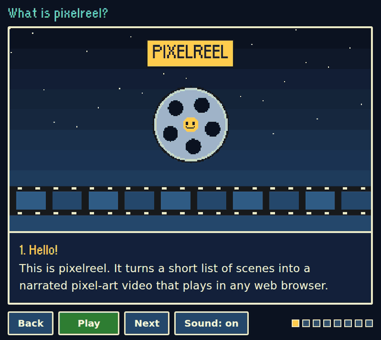

# pixelreel

Narrated pixel-art explainer videos, made from a short list of scenes.

You write a reel as one small JavaScript file: a title, then a list of scenes, each with a
caption, the words to say and a picture, drawn in code or picked ready-made. pixelreel plays
it in the browser like a video, with a warm recorded voice-over, captions, transitions and a
progress bar. No video editor, no build step, no server code.



**Watch the example:** [ollysalanson.github.io/pixelreel](https://ollysalanson.github.io/pixelreel/)
(two minutes, with sound; it explains pixelreel itself).

## What you get

- **A browser player.** Pixel-art pictures on a 320 x 180 canvas, large readable captions
  (typed out as the narrator speaks, if you like), a progress bar to scrub through, and
  Play/Pause, Back, Next and Sound buttons. Pause holds the frame; Play carries on from the
  same moment. Keyboard: Space, the arrow keys and M.
- **Scenes as data.** One `reel.js` per reel. Draw pictures with the pixel kit (sprites,
  scrolling hills, tweens with bounce, confetti, a camera that shakes and zooms) or skip the
  drawing and pick a ready-made picture: a title, a list, a terminal, code, a chat.
- **Transitions.** Dissolve, wipe, slide, blinds, iris, fade, flash and, for the brave, star.
- **Offline narration.** `npm run voices` records every scene with
  [Kokoro](https://huggingface.co/hexgrad/Kokoro-82M), an open speech model that runs on an
  ordinary CPU. Or bring any other speech engine, or your own voice.
- **A fallback voice.** A scene with no recording yet is read aloud by the browser, so a
  brand new reel plays straight away.
- **Share it anywhere.** A reel is plain files: a GitHub Pages workflow is included, `?embed`
  fits it in an iframe, and the banner maker turns a few seconds into an animated picture
  for a README.
- **Machines welcome.** `npm run new -- --from notes.md` turns a Markdown script (or release
  notes) into a reel, `npm run check` says exactly what is wrong with one, and an example
  workflow makes a narrated reel for every release.

## Quick start

You need [Node.js](https://nodejs.org/) 20 or newer.

```sh
git clone https://github.com/OllySalanson/pixelreel.git
cd pixelreel
npm start
```

Open <http://localhost:8000/> and press Play. (Browsers will not load modules or audio
from a page opened straight from disk, so `npm start` runs a tiny local web server.
`PORT=9000 npm start` picks another port.)

Start your own reel:

```sh
npm run new my-reel                         # makes reels/my-reel/reel.js
npm run new my-reel -- --title "My reel"    # or give it a title
npm run new my-reel -- --from notes.md      # or lay it out from a Markdown script
```

Then open <http://localhost:8000/?reel=my-reel>. Edit `reels/my-reel/reel.js` and reload
to see your changes. Until you record voices, the browser reads each scene aloud.

## Write scenes

```js
export default {
  title: 'How tea is made',
  transition: 'dissolve',
  captions: 'typewriter',
  scenes: [
    {
      title: 'Picking',
      caption: 'Only the top two leaves and a bud are picked.',
      say: 'First, the picking. Only the top two leaves and a bud are taken from each bush.',
      draw(t, px) {
        px.sky('#0b1220', '#24476b');
        px.hills('#1f3b5e', 150, 24, t * 8);
        px.sign('PICKING', px.W / 2, px.tween(t, 0.5, 1, -30, 20, 'bounce'), 16, '#ffcc4d');
      }
    },
    {
      title: 'You will need',
      caption: 'A kettle, a teapot and a little patience.',
      picture: { type: 'list', items: ['A kettle', 'A teapot', 'Patience'] }
    }
  ]
};
```

Each scene has a `title`, a `caption` to read along with, the words to `say` (leave it out to
read the caption) and a picture: a `draw(t, px)` function, where `t` is seconds since the
scene started and `px` is the pixel kit, or a ready-made `picture`. When the narration ends
the player moves on by itself.

[docs/scenes.md](docs/scenes.md) has every field, every ready-made picture, every
transition and every kit helper, each with a tiny example. To check one picture by eye,
open `?reel=my-reel&scene=3&t=12`: scene 3, held at twelve seconds in. `npm run check my-reel`
checks the whole reel without a browser.

## Record the voices

```sh
scripts/setup-voices.sh      # once: Kokoro and its model files, about 350 MB
npm run voices my-reel       # one small MP3 per scene
```

Only lines that changed are recorded again. Pick another of Kokoro's voices with
`-- --voice bf_emma`, plug in another speech engine with `-- --command "..."`, or record
lines yourself. [docs/voices.md](docs/voices.md) has the details.

## Share it

The player and reels are static files, so any web host works. The included workflow
(`.github/workflows/pages.yml`) publishes the site to GitHub Pages on every push to `main`
once you set **Settings > Pages > Source** to **GitHub Actions**.
[docs/sharing.md](docs/sharing.md) covers embedding a reel in a page, making a README
banner, building a reel from a script or release notes, a reel for every release in CI,
and letting an AI agent write one.

## Project layout

```
index.html                  the player page
export.html                 the banner maker
src/                        the player: main.js (page), player.js (timing), narrator.js
                            (clip, browser voice or timer), reel.js (checks a reel), kit.js
                            (pixel kit), pictures.js (ready-made pictures), transitions.js,
                            timing.js, load.js, and png.js and flipbook.js for banners
reels/<name>/reel.js        a reel
reels/<name>/audio/         its recorded clips and manifest.json
scripts/                    npm start, new, voices and check, setup-voices.sh
docs/                       how to write scenes, record voices and share reels
test/                       unit tests (node --test)
fonts/                      Orange Kid, the pixel font (CC0)
```

## Develop

```sh
npm install     # the linter
npm test        # unit tests: player timing, narrator, kit, pictures, transitions, tools
npm run lint
npm run check   # every reel valid, and how much of it is recorded
```

## Licence

pixelreel is released under the [MIT licence](LICENSE).

It stands on the shoulders of:

- **[Kokoro-82M](https://huggingface.co/hexgrad/Kokoro-82M)** by hexgrad, the speech
  model that records the narration. Its weights are released under the Apache 2.0 licence.
  pixelreel does not include the model; `scripts/setup-voices.sh` downloads it.
- **[kokoro-onnx](https://github.com/thewh1teagle/kokoro-onnx)** by thewh1teagle (MIT),
  which runs Kokoro on the CPU and hosts the model files used here.
- **Orange Kid**, the pixel font, by Ray Larabie of
  [Typodermic Fonts](https://typodermicfonts.com/), released under
  [CC0](https://creativecommons.org/publicdomain/zero/1.0/) (public domain). See
  [fonts/LICENSE.txt](fonts/LICENSE.txt).

The example reel's narration was recorded with Kokoro, voice `bm_george`.
