# The website

The website at the service's own address ([pixelreel.pro](https://pixelreel.pro)): what Pixel
Reel is, how to add it to Claude, the press kit, and privacy, terms and credits. The
[service](../service.md) serves it, and everything it shows lives in [`site/`](../../site).

- [Who it is built for](#who-it-is-built-for)
- [How it fits together](#how-it-fits-together)
- [On a phone's home screen](#on-a-phones-home-screen)
- [Who reads](#who-reads)
- [Changing it](#changing-it)
- [The reels it plays](#the-reels-it-plays)
- [Design log](#design-log)

## Who it is built for

People who find reading hard work. Every choice follows from that:

- **Letters.** Lexend, large (20px, 18px on a phone), with open spacing and lines no longer
  than about 60 characters. Never justified, never in italics, never all in capitals for a
  sentence.
- **Words.** Short sentences in everyday words, a few to a section. No walls of text.
- **Whole words.** No word is ever cut in two at the end of a line, whatever the screen and
  the letters. When there is not room, things go under each other instead.
- **Paper.** Dark ink on cream rather than black on white, which dazzles some readers.
  Words never sit on a pattern or a picture: even the stars keep clear of them.
- **Buttons.** Every main thing to do is a big button that says what it does.
- **Make it comfy.** A panel on every page changes the letters (Lexend, Atkinson
  Hyperlegible Next or OpenDyslexic), their size and spacing, the colour of the paper (cream,
  five tints or dark),
  whether pictures move, how fast a reel is read, and whether every word he says is written
  under the pictures. It is kept on the reader's device only.
- **A ruler to keep your place.** Make it comfy can lay a clear band across the page, with
  the rest dimmed, that follows the pointer or a finger: the reading ruler many dyslexic
  readers use on paper. It gets out of the way of a reel that is playing.
- **Nothing lost with the sound off.** A reel shows a few words and Peter says the rest.
  With the sound off, every word he says is written under the picture instead.
- **A place kept in the words.** Where every word is written, the sentence being said is
  gold as it is said, so nobody has to hunt for where the voice has got to.
- **As big as the screen.** Every player has a button in the corner of its picture that
  fills the whole screen with the reel, for anyone who needs it large, or is watching on a
  phone held on its side.
- **On paper, too.** Under a reel, every scene is laid out on one page: its picture and its
  few words. Print it, and how to read the gas meter is on the fridge. The paper carries the
  reel's own QR code, so pointing a phone at the fridge has it read out.
- **Watch instead.** Every part of the home page has a "Make a pixel reel about this" button
  that plays a reel of that part, made earlier. "Watch this whole page" plays them all.
- **Calm.** Sound only ever starts on a press. Pictures hold still for anyone whose device
  asks for less motion, or who chooses Still.
- **One press away.** Pixel Reel can be added to a phone's home screen, so nobody has to
  type an address or find a tab again. It opens there with no internet, too.
- **No address to type.** To get from a computer to a phone, point the phone's camera at
  a square of pixels (a QR code). Typing an address letter by letter is its own kind of
  reading.

Pixel art is for pictures; words are always in plain letters. One pixel of the page's pixel
art is `--u` (4px) wide everywhere, so buttons, borders, icons and scenery sit on one grid.

The site's own voice is Peter's: warm, plain, British, a little cheeky. Plain dashes only.
Peter reads every reel the site plays, and every made reel unless someone chooses another
narrator ([Who reads](#who-reads)).

## How it fits together

| File | Does |
| --- | --- |
| `site/layout.html` | The shell every page shares: the bar across the top, the foot, Make it comfy and the theatre. |
| `site/pages/*.html`, `*.md` | A page each. The comment at the top holds its `title` and `description`. Plain pages are Markdown. `reel.html` is the page every shared reel is watched on (`/r/<id>`), and `watch.html` the page each of the site's own reels has to be sent by (`/watch/<name>`: the examples in `EXAMPLES`, in `service/site.mjs`, which also writes their posters). |
| `site/css/site.css` | The whole look. |
| `site/js/` | `main.js` wakes the page up; `player.js` is the player; `theatre.js` plays a reel over the page; `shots.js` draws reel pictures as illustrations; `scenery.js` and `landscape.js` draw the night scenes; `comfort.js` is Make it comfy; `boot.js` runs before the page is drawn, to put its settings back and to keep the bar across the top on one row; `signal.js` is the test card on a page that is not there; `maker.js` writes what to say to Claude; `watch.js` is the page a shared reel is watched on; `send.js` copies words and passes a reel on; `ruler.js` is the reading ruler; `pace.js` is the clock that lets Peter read slower or quicker; `sprites.js` is the site's own pixel art. |
| `site/js/menu.js` | The menu a Menu button opens, where the bar across the top has no room for its links (`boot.js` decides): the same links as big rows, with Make it comfy and the way to add Pixel Reel to Claude. A link added to the bar goes in the menu too (a test says so). |
| `site/js/qr.js` | Makes a QR code from an address, with nothing loaded from anywhere else. The service draws it into a page where the page says `{{scan}}`: the code that opens the page about the phone. |
| `site/js/app.js`, `site/js/sw.js` | Pixel Reel as an app on a phone: [below](#on-a-phones-home-screen). |
| `site/js/sheet.js` | The whole reel on one page, under the player on a reel's page: every scene's finished picture with its few words, to glance over and to print. The print rules at the foot of `site.css` leave nothing else on the paper. |
| `site/js/follow.js` | Following the words: splits a line into its sentences and works out which is being said, for the player to mark where every word is written. |
| `site/fonts/`, `site/art/` | The fonts (with their licences), and the icons, logos and share picture. |
| `service/site.mjs` | Puts a page together: the layout, the page, and the `{{names}}` in them. |
| `service/static.mjs` | Serves the files a page loads, and only those. |
| `scripts/site-art.mjs` | Draws `site/art/` from the sprites and the landscape (`npm run site-art`). |
| `site/js/given.js`, `service/try.mjs`, `service/writer.mjs` | Make it right here, where the service has Claude write a reel for a visitor from what they type, paste, drop or photograph. Off by default: [service.md](../service.md#make-it-right-here). |

A page can say `{{url}}`, `{{mcp}}` (the connector's address) and `{{add}}` (the link that
opens Claude with the connector filled in), `{{icon:letter:4}}` for an everyday icon and
`{{sprite:reelie:2}}` for one of the site's own, drawn as crisp SVG four (or two) pixels to
the pixel, `{{player:pixel-reel}}` for a player of a reel in `reels/`, and `{{scan}}` for the
QR code that opens the page about the phone (`{{scanthis}}` for one that opens the page it
is on, as a reel's page has).

The player is the real one underneath: `site/js/player.js` uses the same timing, narrator,
kit and transitions as `src/main.js`, with the site's own buttons round it. The pages work
without JavaScript, except that reels need it to play.

A page loads nothing from anywhere else, sets no cookies, and its content security policy
(`SITE_POLICY` in `service/site.mjs`) allows only the site's own files. That rules out
inline styles and scripts, so pages have none (`test/site.test.js` checks).

An address that is nearly right still gets there. A link to a reel is often copied with
the full stop or the bracket that came after it in a message, and an address is often typed
with a capital letter or a slash on the end, so the service sends those on to the address
that was meant (`addressMeant` in `service/site.mjs`: `/r/<id>.` to `/r/<id>`, `/Claude/` to
`/claude`). It never changes a reel's id, in which capitals count, and it guesses at
nothing: an address that is not near one of the site's own gets the usual "Nothing here",
and anything else under `/r/` gets "No reel here", which says the link may not be right.

Search engines are asked to keep out (`noindex`, and `/robots.txt`) for as long as Pixel
Reel is by invitation. `PIXELREEL_LISTED=1` lets them list the website. Reels are never
listed: every `/r/` answer says `noindex`.

## On a phone's home screen

Pixel Reel can be added to a phone's home screen, where it opens on a screen of its own like
any other app (an installable web app). Three things make it one:

- **What a phone is told** (`site/art/site.webmanifest`, written by `appManifest()` in
  `service/site.mjs`, and drawn into `site/art/` by `npm run site-art`): its name and icons, that it opens on a screen of its own, and
  what to offer when its icon is pressed and held. The `maskable` icons keep Reelie well
  inside the middle, as a phone may cut an icon into a circle.
- **The service worker** (`site/js/sw.js`, served as `/sw.js`, because a browser lets a
  worker look after only the pages beside and below its own address). It keeps a copy, on
  the device, of each page the site has shown, the files they load, and each of the site's
  own recordings that has been played. With a connection everything still comes from the
  service, as fresh as ever, so a change to the site shows on the next visit: a kept copy
  is only for when there is no connection, when the service is in trouble, or when it has
  not answered in four seconds. A page never kept is answered with `/offline`. It never
  keeps what the service says not to (`no-store`, as a made reel's page is), and leaves
  `/mcp`, `/try` and video alone. Change how it keeps things, and change the number at the
  end of its caches' names, so that it throws away what the older version kept.
- **The page that shows how** (`/app`), and `site/js/app.js`, which starts the worker and
  works anything with `data-install`. Chrome on Android (and on a computer) will do the
  adding itself, so there the button does it in one press. An iPhone will not, so there the
  button leads to the steps, and the page opens with the ones for the device in hand first.

- **Reels kept to play with no internet** (`site/js/kept.js`). A made reel belongs to
  whoever has its link, so nothing of it is kept unless someone asks: with "Keep it on this
  phone" on its page, or by having Pixel Reel on their home screen, where each reel they
  open is kept for them. A kept reel is its page, its `play.json` and its recordings, in a
  store of its own (`KEPT` there, `REELS` in the worker: the same name). The worker still
  asks the service first, and answers from the kept copy only when the service cannot be
  reached. The copy goes when the service's does: on the day `play.json` says the reel is
  kept until, or at once if the service says the reel has gone. The page shown when there
  is no internet lists the kept reels, as posters to press.
- **Sharing to it** (`site/js/shared.js`). On Android, an app on the home screen is offered
  in the phone's Share menu. The manifest's `share_target` has the phone send what was shared
  to `/share`, where the worker puts it by, on the phone, and brings up the home page at the
  make-one box. `shared.js` then hands it to the box the way a person would: a link or words
  go in the box, a file goes to the box's own file chooser. Where the box makes reels itself
  (Make it right here) it starts at once, as it does for a drop; where it does not, the
  words for Claude are ready to copy. Only there does the manifest say a file may be shared
  (the service writes it then, `appManifest({ files: true })`), or a phone would offer Pixel
  Reel for a photo it cannot take. Nothing shared is sent to the service by the sharing
  itself. If the worker is not there to take it, the service answers `/share` by sending the
  browser on to the box, without reading what was sent.
- **The lock screen.** While a reel plays, the player tells the phone what it is
  (`tellPhone` in `site/js/player.js`, the browser's Media Session): the scene, the reel and
  Reelie's picture show on the lock screen, and Play, Pause, Next and Back there, on
  headphones or in a car do what the player's own buttons do.

`test/app.test.js` runs the worker in Node with stand-ins for a browser's caches and network.
To try it for real, open the site in a browser, stop the service, and reload: pages already
opened still show, a reel of the site's already played still plays, and so does a made reel
that was kept.

## Who reads

Peter, unless someone chooses otherwise. Where the service offers other narrators
(`PIXELREEL_NARRATORS`, [service.md](../service.md#other-narrators)), the part of the home
page about the voice has a card for Peter and one for each of them: a name, whether it is a
man's voice or a woman's, a button to hear them say hello, and one to choose them.

- `narratorsHtml()` in `service/site.mjs` writes the cards, for the narrators the service
  says it has, and nothing at all where it has only Peter. `NARRATORS` there names each
  one's hello.
- **A hello is a reel of one scene**, `reels/voice-anna` and so on, recorded in that
  narrator's own voice (`npm run voices voice-anna -- --voice anna`; Stuart's voice is
  `stuart_bell`). "Hear Anna" plays its first line, the way "Hear Peter say hello" plays
  the first line of `site-peter`. A new narrator needs one, and a test says so.
- `site/js/voice.js` keeps the choice on the device and says who was chosen. The make-one
  box asks it, so the words it writes for Claude say who should read: "Make me a pixel
  reel, read by Anna, about this: my gas bill".
- **In which language** is chosen in the make-one box itself ("Read it to me in"), wherever
  the service can read more than English, and is said in the same words: "Make me a pixel
  reel in French, read by Anna, about this: my gas bill".
- A reel's own page names whoever is reading while it waits ("Anna is recording scene 3 of
  6"), from what the service says of the reel.
- **Where each voice comes from is on the credits page, and has to be.** Peter's and
  Stuart's are modelled on public domain readings (Voice-Zero, CC0). Anna's, Vera's,
  Charles's and Paul's are modelled on recordings from the CSTR VCTK Corpus, whose licence
  (CC BY 4.0) asks for credit. `NARRATORS` says which (`from`), and a test fails if the
  credits page leaves one out. Every narrator is modelled on a real person's recording, so
  the site never says otherwise: what it says is that Pixel Reel cannot be made to copy
  anyone else's voice.

## Changing it

```sh
npm run service          # http://localhost:8787, picking up changes on reload
npm test                 # test/site.test.js and test/service.test.js cover the site
npm run site-art         # after changing Reelie or the landscape
```

Look at every change at three sizes (1440 x 900, 1280 x 720 and 390 x 844), and with
Make it comfy set to Dark, to Biggest, to OpenDyslexic (a third wider than Lexend, so it
finds what does not fit) and to Still.

No test can see how a page is laid out, so [`scripts/site-fit.js`](../../scripts/site-fit.js)
does it in a browser: paste it into the console of a page, at a phone's width and at a
laptop's, and it tries all 27 settings of Make it comfy and says where the bar across the
top is on two rows, where a word is cut in two, where words sit on a pattern in one of the
night scenes, and where the page is wider than the screen. Fix a layout it complains about by letting it reflow (a `flex-basis` or a column
width in `ch`, which grows with the letters), not by a rule for one size of screen.

Three things it cannot see, so look at them by hand:

- **Inside a dialog** (the menu, Make it comfy, the theatre). Open it with `showModal()`
  and compare its `scrollWidth` with its `clientWidth`, at 320 pixels wide with
  OpenDyslexic, the biggest size and the roomiest spacing.
- **What only someone with a mouse is shown** (the QR code and its words, `.scan`). A
  headless browser says it has no mouse, so the rule never applies there. Switch it on by
  setting that rule's `media.mediaText` to `screen` through `document.styleSheets`.
- **The printed page.** Set every `@media print` rule's `mediaText` to `screen` the same
  way, at 794 by 1123 pixels, which is a sheet of A4.

A device is told apart by what the browser says it is (`deviceOf` in `site/js/app.js`), so
to see what a phone is shown (`data-on-phone`), give the headless browser an iPhone's user
agent. To check that a QR code reads, a reader such as zxing-cpp will read one from a
screenshot.

## The reels it plays

All are `reel.json` reels in `reels/`, written the way Claude writes them through the
connector (ready-made pictures only) and recorded by Peter with `npm run voices`:

| Reel | Where |
| --- | --- |
| `pixel-reel` | The player at the top of the home page. |
| `site-what`, `site-how`, `site-who`, `site-peter`, `site-make`, `site-good`, `site-phone`, `site-questions` | "Make a pixel reel about this", one for each part of the home page. With `site-open`, they are also "Watch this whole page". |
| `site-make-here` | "Make a pixel reel about this" beside the make-one box where the box makes the reel itself (Make it right here): it takes `site-make`'s place there, and in "Watch this whole page". |
| `site-open` | The reel for "It is all open", and the code typing out beside it. |
| `voice-anna`, `voice-vera`, `voice-stuart`, `voice-charles`, `voice-paul` | Each narrator's hello, one line in their own voice, for "Hear Anna" and the rest ([Who reads](#who-reads)). |
| `site-privacy`, `site-terms` | "Make a pixel reel about this" on the privacy and terms pages. A plain page gets the button by naming a reel in the comment at its top (`reel: site-privacy`). |
| `gas-meter`, `pension-letter`, `volcano`, `cup-of-tea`, `offside-rule`, `blue-sky` | The examples under Now showing. `pension-letter` also plays beside the letter in "Same letter, two ways". |

Change a reel's words and it needs recording again (`npm run voices <name>`); a test fails
until it is. Change what a part of the page says, and change its reel to match. A picture's
`start` and `every` are set to when Peter says the words, so check them after re-recording.

## Design log

### Before (22 November 2026)

The home page was five paragraphs of Markdown on dark blue, with a text link to add Pixel
Reel to Claude. Nothing to watch, on a site about watching.

| Desktop | Phone |
| --- | --- |
|  |  |

### Version 1

A first whole page: a night-sky top with the player beside the headline, then cream paper for
reading. What was wrong with it, looked at hard:

- The headline broke into three lines, and pushed the buttons off the first screen.
- Words sat on a dithered sky and among the stars, which is hard on exactly the readers the
  site is for.
- The big Play button sat on top of the reel's own title.
- The landscape was below the fold, so the first screen ended in plain dark blue.


### Version 2

- The headline is two lines, as it is said: "Watch it. Don't read it."
- The sky is plain behind every word. Stars keep out of the way of text, and the dawn glow
  starts below it.
- Play sits under the reel's title, not on it.
- The whole first screen fits a laptop: headline, both buttons, the player, and the hills
  with Reelie on them.
- The page turns from night to day as the hills meet the paper, and back to night at the
  foot, where Reelie is asleep.
- Phone: the bar across the top fits on one line, the player's buttons fit on one row, and
  lists put their icon beside the words to save scrolling.
- Found by looking at a picture of it: the theatre could open off the screen when the page
  was scrolled. Fixed.

| Desktop | Laptop |
| --- | --- |
| 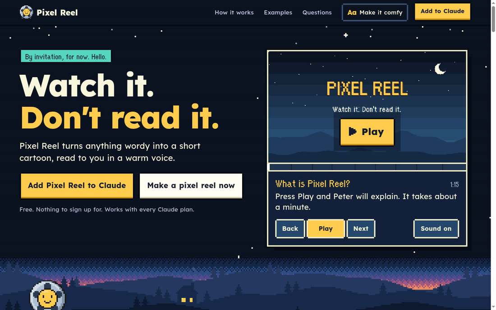 |  |

| Now showing | A reel about a part of the page | Phone |
| --- | --- | --- |
|  |  |  |

### Version 3

Looked at again, version 2 explained Pixel Reel well but never let anyone feel the
difference, and the middle of the page was all cream cards.

- **Same letter, two ways.** Straight after the top, a dense pension letter (small, grey,
  justified: everything this site is not) sits beside the reel of the same letter. The
  letter is a picture of a letter, hidden from screen readers, who are told what it is.
- **Watch this whole page.** A button at the top plays the reel for each part of the page,
  one after another: the whole site, as a reel. Next on a reel's last scene skips on.
- **Pictures on the word.** Every clip was run through speech-to-text to find when each word
  is said, and each list, row of icons and chat now arrives as Peter says it. An answer no
  longer shows before its question has been asked.
- **Colour.** The "who it is for" cards have a coloured tile behind each icon.
- **The big Play button** keeps off the picture's own words: under a title, in the middle
  of anything else.
- **A way home.** Every shared reel's page now says "Made with Pixel Reel" under the player.
- **Checked by machine as well as by eye:** Lighthouse gives accessibility 100 and best
  practices 100 on the home, Claude, press and privacy pages at phone size. It found one
  real fault: on a phone the Make it comfy button had no name for a screen reader. Fixed,
  and a test now checks every button has one.
- **Faster:** a page now asks for all its scripts at once, and the first reel with them,
  rather than finding out about each from the one before.

| The top, with Watch this whole page | Same letter, two ways | Who it is for |
| --- | --- | --- |
|  |  |  |

### Version 4

The page a shared reel lands on is where most people will meet Pixel Reel, and it still
looked like the old site.

- **A shared reel's page** (`/r/<id>`) is now the website's own: the same player, Make it
  comfy, a night sky, and "Want one of your own?" underneath. It says how long the reel is
  kept, and offers the video once one has been made.
- **Waiting is a scene of its own.** The page used to say "Nearly ready" and reload itself
  every five seconds. Now it is there at once, Reelie waits on screen under a RECORDING
  sign, and the reel appears the moment Peter has finished.
- **A link sent in a message** shows a card ("A pixel reel for you") and the reel's title.
  The page itself holds none of the reel's words.
- **Privacy and terms, as reels.** Both pages have "Make a pixel reel about this" straight
  under the heading. Nobody reads the terms; now they can watch them.
- **It is all open.** A part of the home page for the curious, with a reel of its own, and
  code typing itself out beside it.
- **Looked at with Make it comfy turned up,** which found two faults: at the biggest
  letters on a phone the bar across the top and the player's buttons ran off the side of
  the screen. Both now wrap. Pictures drawn on a canvas no longer take on the page's letter
  spacing.

| A shared reel | Waiting for the voice | It is all open |
| --- | --- | --- |
| 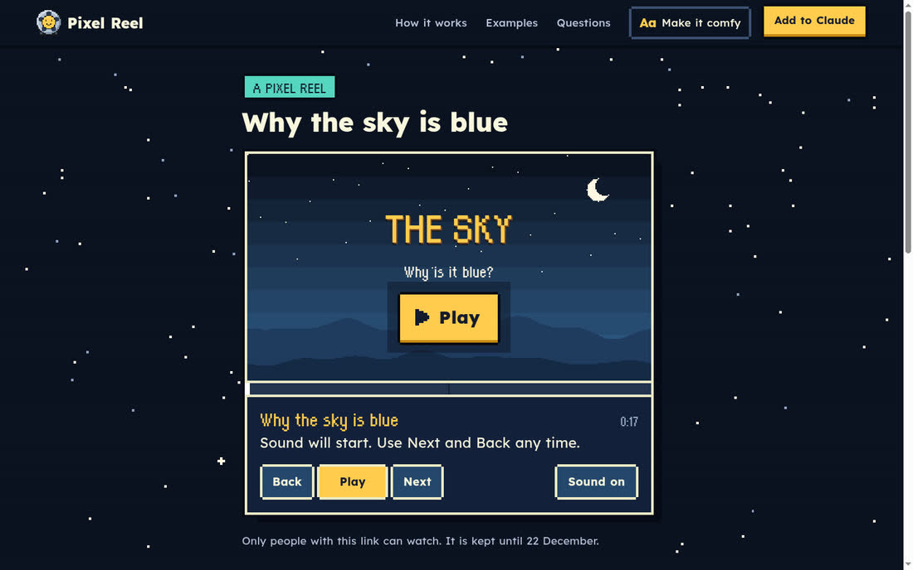 | 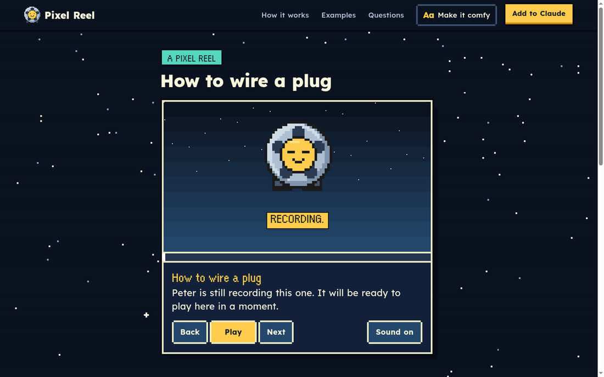 |  |

### Version 5

- **Six examples, not four.** Now showing gains "The offside rule, at last" and "Why the sky
  is blue", each with pixel art drawn for it: a football pitch with the last defender's line
  marked, sunlight fanning out into its colours, a sunset. The posters sit three by two.
- The two questions the make-one box suggests (the offside rule, why the sky is blue) are now
  ones a visitor can watch the answer to on the same page.

| Six examples |
| --- |
|  |

### Version 6

- **Make it right here, built and switched off.** Until now a visitor needed Claude to get a
  reel. The make-one box can now offer a second button that has the service ask Claude for
  them, and takes them to the reel's page to wait for the voice. It costs money for every
  reel, so it is off, and the button is not on the page at all, until it is switched on
  ([service.md](../service.md#make-it-right-here) has the costs and the safeguards).
- Tried with a stand-in for Claude from the button through to a reel ready to play.

| The button, when it is switched on |
| --- |
| 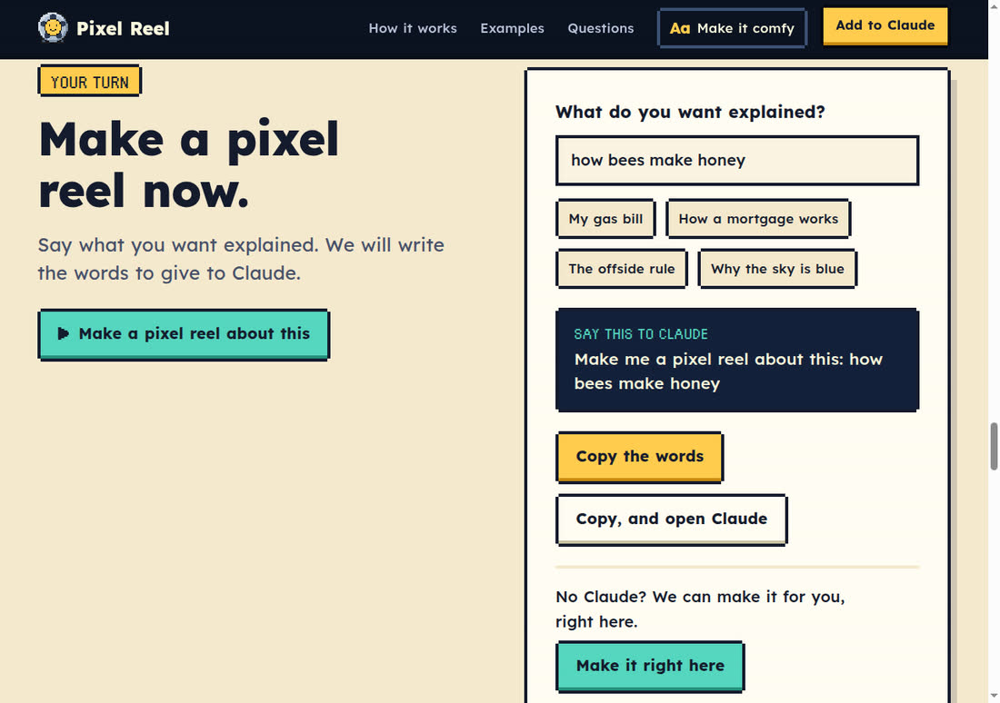 |

### Version 7

- **A film for the press kit.** The reel at the top of the home page, drawn frame by frame
  into an MP4 with `npm run video pixel-reel -- --scale 3`, words on screen, to drop into a
  post or a piece (`site/art/what-is-pixel-reel.mp4`; make it again if that reel changes).

### Version 8

- **The bar across the top stays on one row.** It had been wrapping onto two: on most phones,
  and on a laptop for anyone who chose OpenDyslexic or bigger letters, which is who the site
  is for. Fixed rules could not know how wide the letters would be, so now `boot.js`
  measures, before the page is drawn, and lets go of one thing at a time until the rest
  fits: the links, the words on the comfort button, the name beside Reelie, and last the end
  of "Add to Claude". Checked at fifteen widths, three typefaces and three sizes.
- **Nothing on this channel.** A page that is not there, and a reel that has gone, now show
  the player's own "no signal" test card, flickering (and still, when asked).
- **Reelie says hello**, once, when you first scroll down to it. The scenery is now drawn
  at the page's full resolution, so words in it are as crisp as the page's.
- The focus ring in the bar across the top was dark blue on dark blue. It is white now.
- The player's four buttons fit on one row on a phone again.

| Biggest OpenDyslexic letters on a laptop: before, after |
| --- |
|  |

| On a phone: before, after, and the same with the biggest OpenDyslexic letters |
| --- |
|  |

| A page that is not there | Hello |
| --- | --- |
| 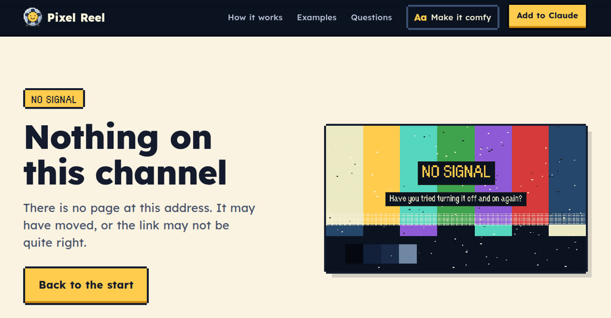 |  |

### Version 9

- **Whole words.** With the biggest letters, the cards in "For anyone who would rather
  watch" cut their words in two: "Readin g", "childre n". Their words now go under the
  picture when there is not room beside it, and the cards go from three across to two when
  three would be too narrow, both measured in the width of the letters themselves.
- The player's buttons share out their rows, so they are tidy on one row or on three.
- Shooting stars pass behind the words now, never across them, and keep clear of the film.
- The connector's address breaks before "/mcp" on a narrow screen, not mid-word, and the
  little arrow after "Show me how" stays with its last word.
- `scripts/site-fit.js` checks all of this in a browser. It finds no fault on the home page at
  18 widths of screen, nor on the other pages at a phone's width and a laptop's.

| Biggest OpenDyslexic letters on a phone: the cards and the player, before and after |
| --- |
|  |

### Version 10

The page a shared reel is watched on is where a reel does its work, so it got the round.

- **Send it to someone.** A reel is made to be passed on, and its page had no way to do it.
  The new button opens a phone's own way of sending things (WhatsApp, a message); on a
  computer it copies the link and says so.
- **A bigger reel.** The page said the reel's name twice, once above the player and once
  inside it, and the first pushed the player down and made it small: about 480 pixels wide on
  most laptops. Now the player says it alone, and is as big as will leave its picture, its
  words and its buttons all on the screen: about 690 wide on a 1280 x 800 laptop.
- **Bigger buttons.** In every player the four buttons now share out their row, so they are
  larger, and tidy however narrow the player. "Sound on" no longer drops off the end.

| A shared reel on a 1280 x 800 laptop: before, after |
| --- |
| 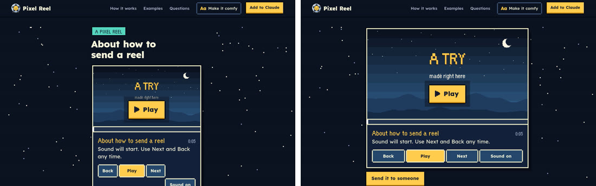 |

### Version 11

- **A reel's link shows the reel.** Sent in a message, every reel's link used to show the
  same card. Now it shows that reel's own first picture, in a frame, over a band with a
  play button, the reel's name and Reelie: "GAS METER", not "A pixel reel for you". The
  service draws it (`service/card.mjs`) the first time a message asks, which can be before
  the voice is recorded, and keeps it with the reel. The old card still stands in if a
  picture cannot be drawn.

| What a message showed for every reel | What it shows now, for two of them |
| --- | --- |
|  |  |

### Version 12

- **A page for each example, to send.** The reel that explains Pixel Reel, and each of the
  six examples, now has a page of its own: `/watch/pixel-reel`, `/watch/offside-rule` and so
  on. The reel is as large as the screen allows, with Send it to someone under it, then the
  way to get one of your own, then the others to watch. Sent in a message, its link shows
  that reel's own picture. `/watch/pixel-reel` is the one link that explains the whole
  thing to someone in a minute.
- The player that opens over the home page has Send it to someone for those reels too,
  which sends the reel's own page.
- A reel's length now reads the same on its poster as on the player's clock.

| An example's page, on a laptop and a phone | What a message shows for it |
| --- | --- |
|  | 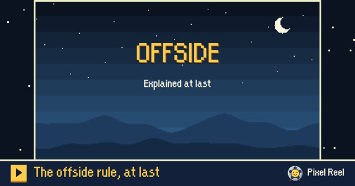 |

### Version 13

- **Words off the pattern, everywhere.** "Words never sit on a pattern" is a rule of this
  site, and on a phone it was being broken twice: "Right then. Your turn." sat on the dusk
  at the foot of the home page, and sleeping Reelie's Zs drifted up across the footer's
  small print. The dusk now ends above the words, however near the top a narrow screen
  puts them, and the Zs fade out before they reach any. The scenes also look again at
  where the words are every time they draw, and keep more plain sky round them, enough
  for OpenDyslexic's tall letters.
- **`scripts/site-fit.js` checks it.** It reads the sky under every run of words that lies
  on a scene, and says where it finds more than one colour. Run on the live site first, it
  found both faults.
- **Know someone who would rather watch?** The foot of the home page has a quiet button
  that sends on the page of the reel that explains Pixel Reel.
- The moon in the footer is smaller and sits above the footer's line, which used to cross it.

| On a phone: the foot of the home page, and the footer, before and after |
| --- |
| 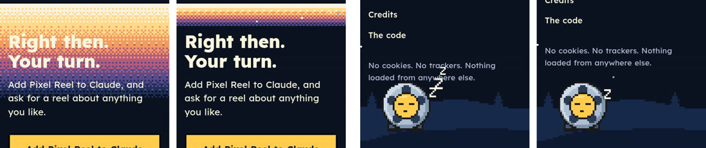 |

### Version 14

- **Peter reads at your pace.** Make it comfy has a new choice, How fast Peter reads:
  Slower, Usual or Quicker. Some people need longer to take a sentence in, and some want to
  get on with it. Every player on the site obeys it, at once, even in the middle of a line,
  and the pictures stay in step with the words: each player keeps time on a clock of its
  own (`site/js/pace.js`), which a slower pace stretches along with the voice.

| The new choice in Make it comfy |
| --- |
| 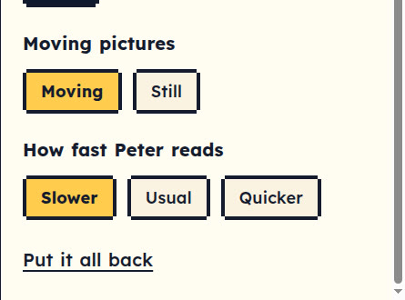 |

### Version 15

- **A reel that ends offers what to do next.** It used to stop on "Play again". Now its
  last picture dims and the page makes its offer there, while the reel is still fresh:
  the reel that explains Pixel Reel offers "Add Pixel Reel to Claude"; a shared reel
  offers "Send it to someone"; an example offers the next example. Each also has "Watch
  it again". A page writes its offer as a `.reel-end` straight after its player, and the
  player moves it over the picture.

| The end of a shared reel, and of the reel on the home page |
| --- |
| 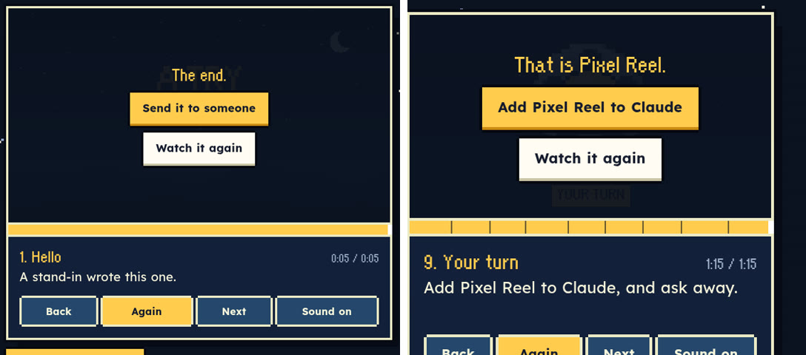 |

### Version 16

- **Make it right here takes the real thing.** Where it is switched on, the make-one box no
  longer writes words for someone to carry to Claude: it makes the reel. One box, one big
  button, and four ways in, so that nobody has to work out which one they are meant to use:
  type a link or a few words, paste some writing (the box grows to hold it), choose a file,
  or drop a link, a PDF, a photo or some writing anywhere on the page. A drop needs no second
  press. On a phone, which has nothing to drag, the same place offers the camera: "Got a
  letter or a bill? Take a photo of it."
- **While Claude writes, the box says only that,** and names what it was given, so there is
  nothing else to read and nothing to press twice. If it cannot be made, the reason comes
  back as a notice of its own above the button, in plain words, and what was dropped is in
  the box to put right.
- Giving the words to their own Claude is still there, one press away, and it is still the
  whole box where Make it right here is off.
- Tried with a stand-in for Claude: typed, pasted, dropped (a link, writing, a PDF) and
  chosen (a photo, on a phone), through to a reel ready to play; at 320, 390, 768 and 1280
  pixels wide; and with `scripts/site-fit.js` at every Make it comfy setting.

| The box | Dragging something over the page, and after it lands |
| --- | --- |
| 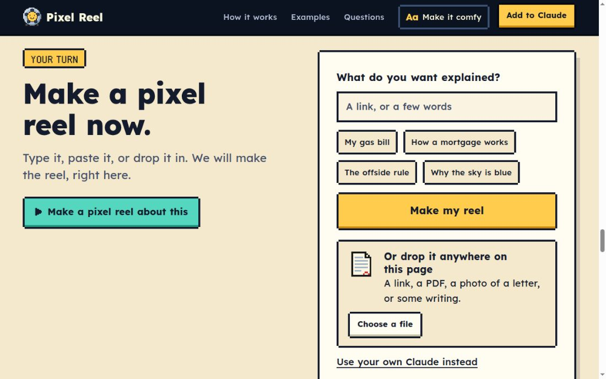 | 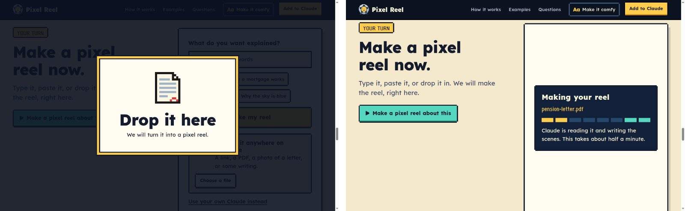 |

### Version 17

- **Reelie is alive.** Its eyes follow the pointer. Press it and it hops and says
  something, a different thing each time ("Tea?", "You rang?"). Press the one asleep in
  the footer and it wakes, says "Mmm?", then "Night night." and goes back to sleep. It
  never speaks over words: its bubble goes beside its head when words are in the way
  above. With pictures held still it does none of this. Reelie is only painted on a
  canvas behind the page, so `scenery.js` watches the pointer for it.

| Pressed at the top of the home page, and woken in the footer |
| --- |
| 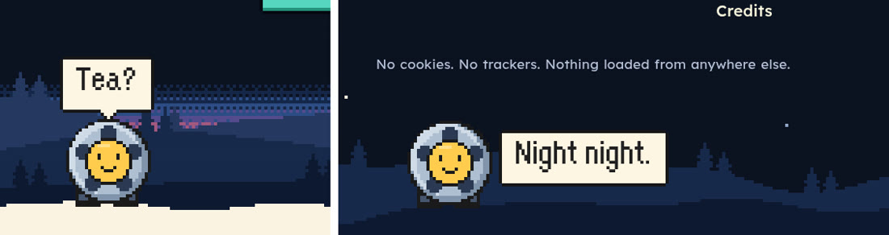 |

### Version 18

- **Every word, for anyone who cannot hear Peter.** A reel puts a few words under each
  picture and Peter says the rest, which left nothing to go on for someone who is deaf, or
  on a quiet train. With the sound off, every word he says is now written under the
  picture. Make it comfy has the same as a choice, Words under the pictures: A few, or
  Every word, for anyone who likes to read along while he talks.

| Every word, under the first picture of the reel on the home page |
| --- |
| 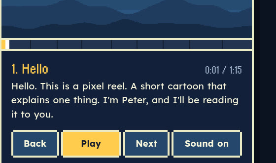 |

### Version 19

- **A reading ruler.** Many dyslexic readers keep their place on paper with a ruler, or a
  strip of card with a window cut in it. Make it comfy now has one for this site: a clear
  band about two and a half lines deep, edged in gold, with the rest of the page dimmed. It
  follows the pointer, a finger, or whatever the keyboard has reached; on a phone the page
  scrolls under it. It gets out of the way of a reel that is playing, nothing can press it,
  and it is kept on the device like every other choice.

| The ruler on a laptop and on a phone |
| --- |
| 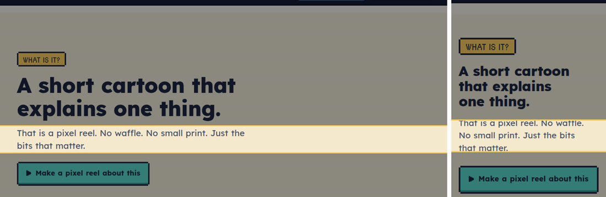 |

### Version 20

- **A reel made here is watched being made.** Pressing Make my reel used to mean half a
  minute of looking at the box, then a second wait on the reel's page. Now the reel has its
  page at once and all the waiting is there, in one place: Reelie, a sign that says what is
  being done ("Writing", then "Recording"), a bar that fills as it is, and one plain
  sentence under it, such as "Peter is recording scene 4 of 6." The reel takes its own name
  as soon as Claude has given it one.
- **The player's buttons are switched off until there is something to play,** rather than
  sitting there in gold, doing nothing when pressed.
- **A reel that could not be made says so where the reel would have been:** "No reel this
  time" on the screen, the reason under it in plain words, and one button, "Try something
  else", which leads back to the box with what was asked about still in it.
- **A notice has a mark.** Where the box says why it cannot make something, the notice now
  carries a red "!" as well as its red edge, so it is known for what it is before a word of
  it is read. Its words go under the mark, never cut in two, when there is no room beside.
  File sizes are no longer given in megabytes: "Give it a shorter one, or only the pages
  that matter."
- On the narrowest phones the box's question is a little smaller, so that "explained?" fits
  at the biggest, widest letters.

| Being written, and being recorded | A reel that could not be made, and a notice in the box |
| --- | --- |
| 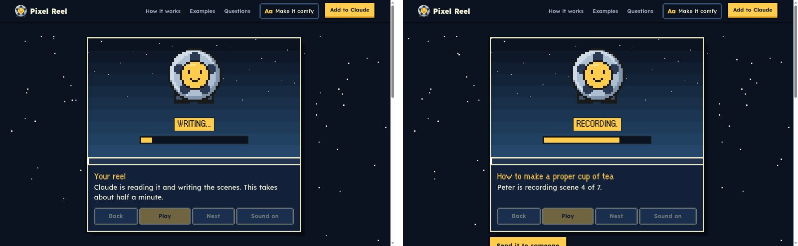 | 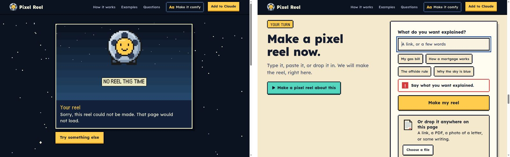 |

### Version 21

- **The wait says how far Claude has got.** While a reel made here was being written, its
  page could only say that it was: the bar crept along on a guess. Now Claude's reply is
  read as it is written, so the reel has its own name within a few seconds, the sentence
  under the screen counts the scenes as they are finished ("Claude is writing it: 3 scenes
  so far."), and each one moves the bar on for certain. Writing still fills only the first
  half of the bar; Peter's recording is the other half.

### Version 22

- **Pixel Reel on a phone's home screen.** It can now be added to a phone like an app: it
  has its own icon, opens on a screen of its own, and needs no app shop. A new page,
  [/app](../../site/pages/app.html), has one big button, "Add Pixel Reel to your phone".
  On an Android phone the button does it in one press. An iPhone will not let a page do
  that, so there the page opens at the two things to press, each with its picture: Share,
  then Add to Home Screen. The foot of every page leads to it.
- **It opens with no internet.** A page that has been opened before still opens on a train
  or in a lift, and a reel of the site's that has been played still plays, voice and all.
  With a connection nothing changes: every page is as fresh as it ever was.
- **Not online.** A page that was never opened, asked for with no internet, shows the test
  card and says so in plain words, with Try again. It tries again by itself the moment the
  internet comes back.
- Tried in a browser with the service stopped: the home page opened and its reel played,
  sound and all. Checked with `scripts/site-fit.js` at 320, 390, 768 and 1280 pixels wide.

| The page that shows how, on a laptop, and the steps an iPhone is shown | With no internet |
| --- | --- |
| 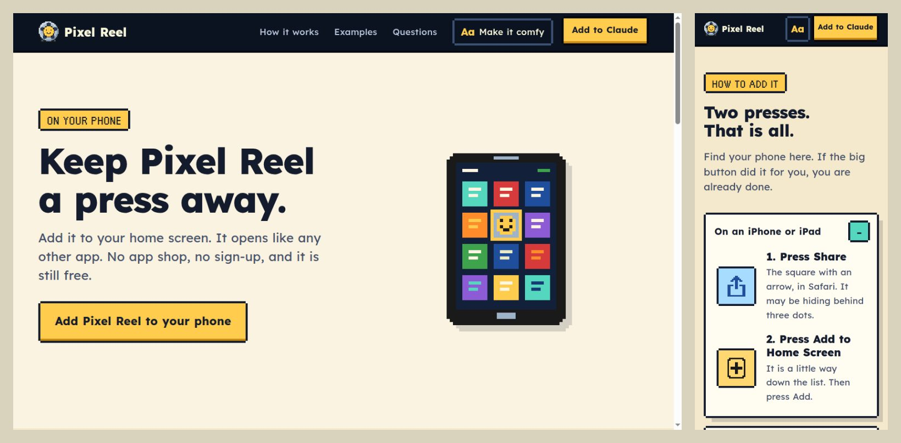 | 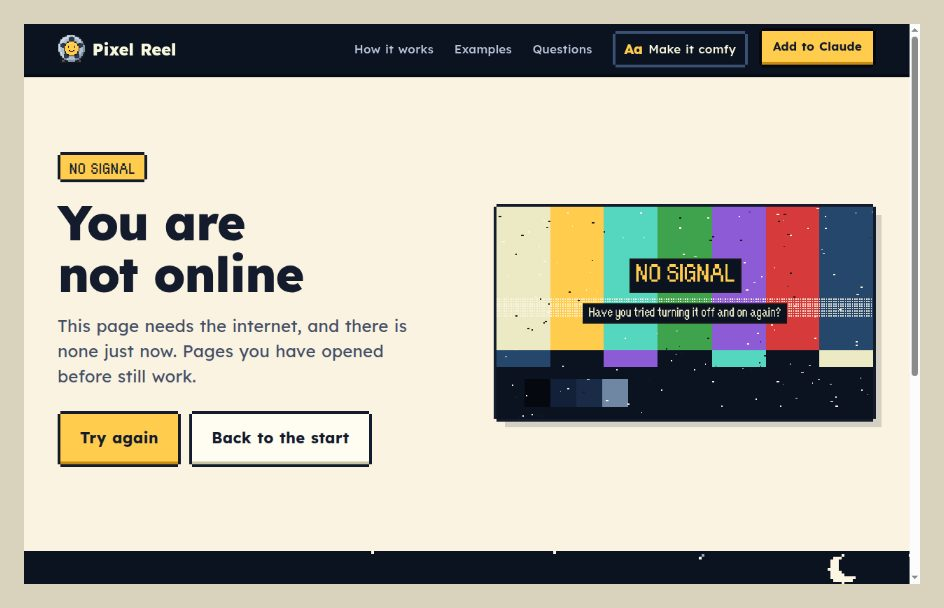 |

### Version 23

- **Make it simpler. Make it shorter.** A reel can still be too much: too many scenes, or a
  word in every sentence that needs explaining. Once a reel plays, its page now asks "Too
  much to take in?" and offers two buttons. Either writes the same reel again, in simpler
  words and smaller ideas, or about half as long, and goes to the new reel's page to watch
  it being made. The first reel stays as it was, so nothing is lost by trying. The buttons
  are there only where Make it right here is switched on.

| Under a reel that is ready to play |
| --- |
| 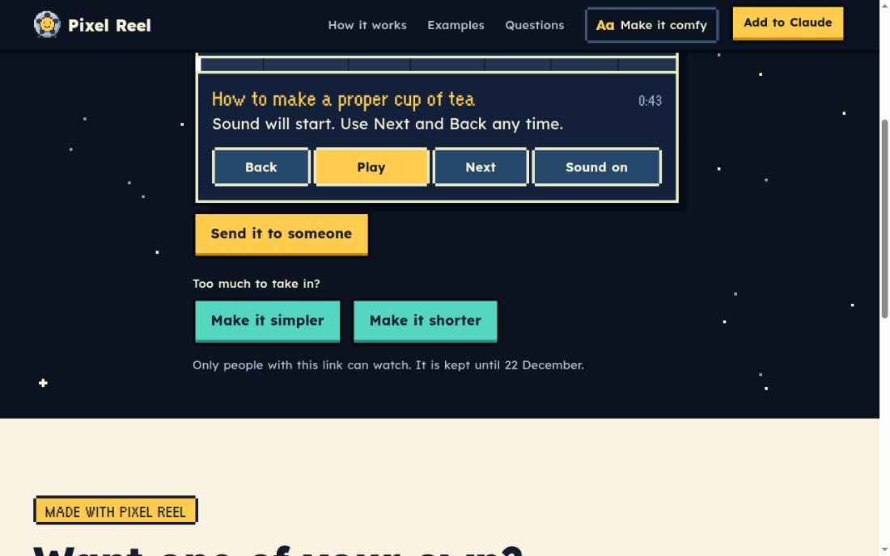 |

### Version 24

- **A reel can be kept, to play with no internet.** A made reel's page has a new button,
  "Keep it on this phone" (or this iPad, tablet or computer: it says which). Pressed, the
  whole reel is kept on the device: its page, its pictures and Peter's voice. After that it
  plays on a train, in a lift, or anywhere else the internet does not reach. The same
  button removes it.
- **For someone with Pixel Reel on their home screen, nothing to press:** every reel they
  open there is kept for them.
- **Your reels still play.** The page shown when there is no internet now lists the reels
  kept on the device, each as a poster with its first picture, how long it runs and the day
  it goes.
- **Kept only as long as the reel is.** A kept copy goes on the day the service deletes the
  reel, and at once if the reel is deleted sooner. Nothing is kept of a reel unless someone
  asks: reels belong to whoever has their link, and a shared computer should not remember
  them.
- Tried in a browser with the service stopped: a kept reel's page opened and played, sound
  and all, and a page never opened showed the kept reels to choose from.

| Kept, on a laptop and on a phone | With no internet: the reels that still play |
| --- | --- |
| 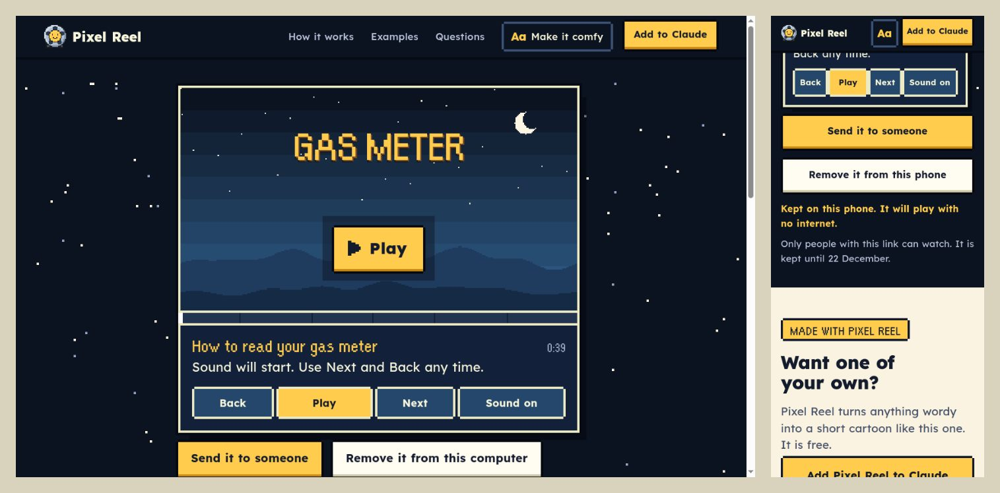 | 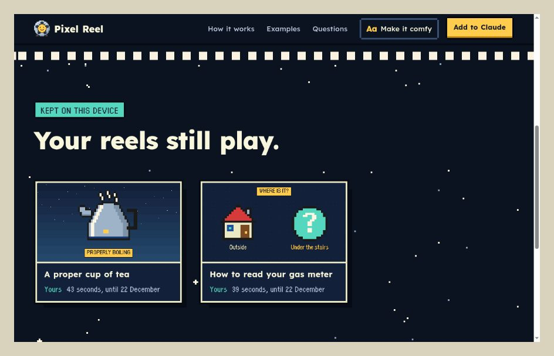 |

### Version 25

- **Share it to Pixel Reel.** On an Android phone with Pixel Reel on the home screen, Pixel
  Reel is now in the Share menu. Reading something long? Press Share, then Pixel Reel. The
  page opens at the make-one box with the link already in it, the words for Claude written,
  and the button to press next in the middle of the screen: "Copy, and open Claude".
- **Where Make it right here is on, there is nothing more to press.** What was shared is
  made into a reel at once, as it is when something is dropped on the page: a link, some
  words, a PDF or a photo of a letter. Only there does the phone offer Pixel Reel for files.
- **Nothing is sent by the sharing itself.** What was shared stays on the phone until the
  box sends it, and is handed over once.
- The page that shows how to add Pixel Reel to a phone says so, under the Android steps.
- Tried in a browser by sending to `/share` what a phone sends: a link landed in the box;
  and with a stand-in for Claude, a PDF and a few words each went straight to a reel.

| The Android steps, and a link shared from the phone, landed in the box |
| --- |
| 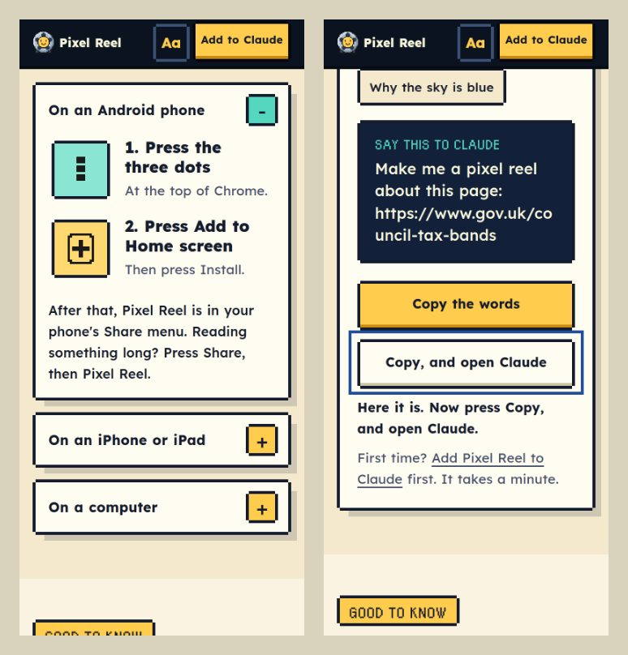 |

### Version 26

- **Your reels.** A reel made here used to be found again only by whoever kept its link.
  Now the home page lists them, under the box: the reels made on this device, newest first,
  each with the day it is kept until. The list is kept in the browser and never sent
  anywhere, so there is still no account, and nothing about anyone on the service.
- **Call it what you like.** Rename puts a name of your own on a reel in the list ("Tea,
  for Mum"), in a box that already holds what it is called now.
- **Delete it for good.** Delete asks once more, in the row itself ("Delete it for good?
  Yes, delete it. No, keep it."), and then the reel is gone at once for everyone, with its
  recordings and its video. Only whoever made a reel can delete it: having its link is
  enough to watch it, never to delete it.

| The list, with one reel renamed and another about to be deleted |
| --- |
| 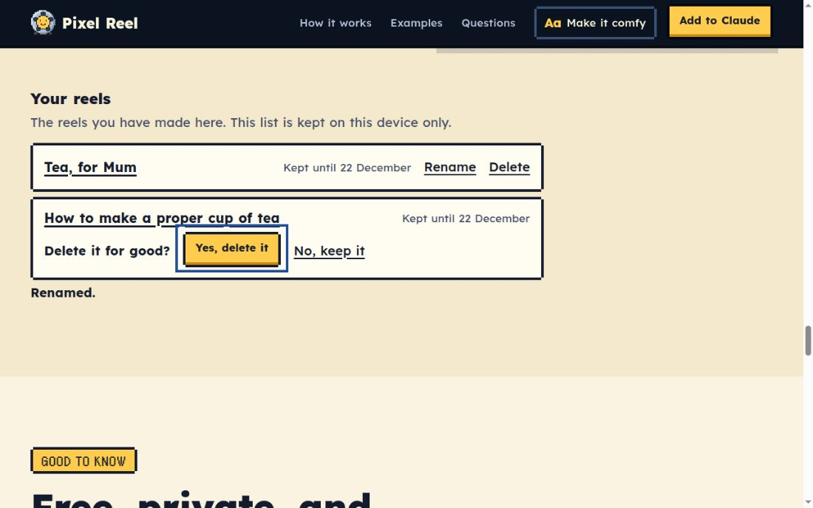 |

### Version 27

- **On your phone, on the home page.** A new part of the home page, after Good to know,
  says Pixel Reel can be kept on a phone, beside the picture of a phone with Pixel Reel among
  its apps. Its button, "Add Pixel Reel to your phone", adds it in one press where the
  browser will, and leads to the steps where it will not. Someone who already has it there
  is not shown this part.
- **A reel of it, read by Peter:** "Make a pixel reel about this" plays `site-phone`, five
  scenes, 34 seconds, and "Watch this whole page" now takes it in. "Is there an app?" joins
  the questions.
- **Two faults on the narrowest phones, found by `scripts/site-fit.js` and already on the
  live site.** At 320 pixels wide with the biggest OpenDyslexic letters, "explaining" was
  cut in two in its card, and the first question was 4 pixels wider than the screen, so the
  whole page slid sideways. Headings in cards and the questions' panels are now a little
  tighter on phones that narrow. The home page is all well at 320, 360, 375, 390 and 1280
  pixels wide, at all 27 settings.

| The new part of the home page, on a laptop and a phone, and its reel |
| --- |
| 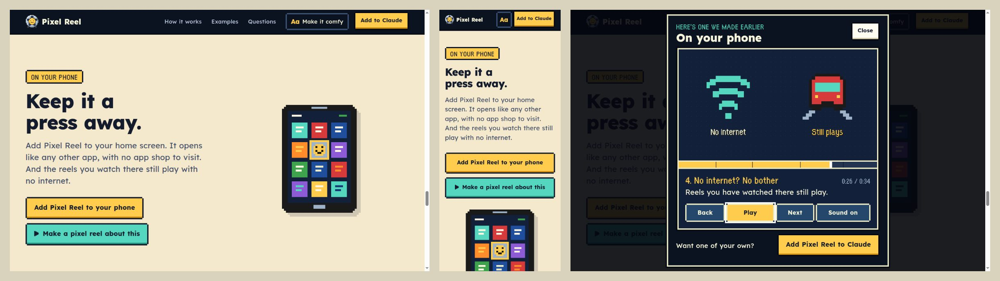 |

### Version 28

- **Choose who reads to you.** Peter is no longer the only narrator. Under Meet Peter there
  is now a card for each of them: Peter, Anna, Vera, Stuart, Charles and Paul. Each says
  whether it is a man's voice or a woman's, and has two big buttons: Hear, which plays that
  narrator saying hello in their own voice, and Choose, which turns gold and says Chosen.
  Under the cards the page says who will read. Peter is chosen until someone picks another,
  and the choice is kept on the device.
- **The words for Claude say who.** With Anna chosen, the make-one box writes "Make me a
  pixel reel, read by Anna, about this: my gas bill".
- **The site no longer says there is only Peter.** The lead under Meet Peter, Peter's own
  reel (two lines recorded again), the question "Can someone else read it?", the press kit
  and the terms all say there is a choice. They still say what has not changed: no voice
  can copy a real person.
- **A reel's page names whoever is reading** while it waits: "Anna is recording scene 3 of 6".
- The cards are shown only where the service offers other narrators, and only for the ones
  it offers. Three across on a laptop, one to a row on a phone with its two buttons side
  by side. All well at 320, 390, 768 and 1280 pixels wide, at all 27 settings.

| The cards on a laptop, with Anna chosen, and on a phone |
| --- |
| 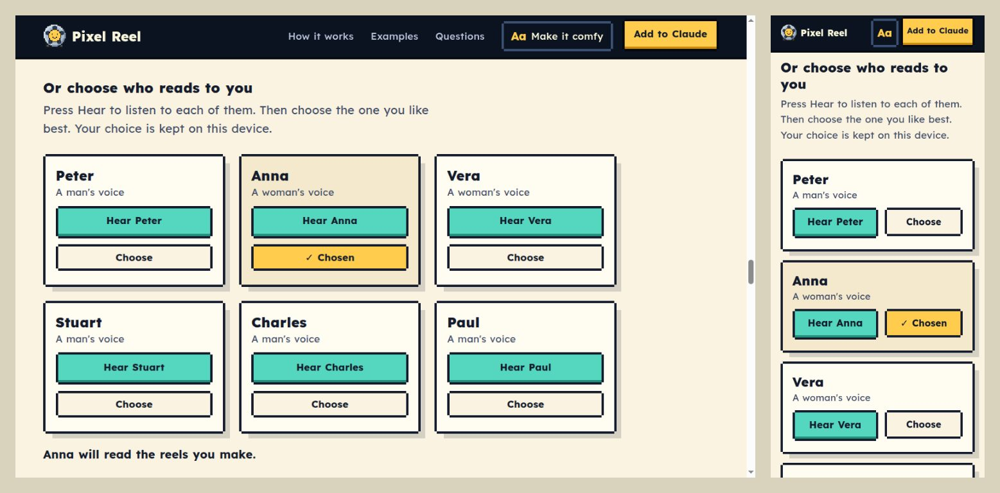 |

### Version 29

- **A reel can fill the screen.** Every player has a new button in the corner of its
  picture. Pressed, the reel takes the whole screen: the picture as large as the room above
  its words and buttons allows, on plain night. The same button puts it back, and so do F
  and Escape. "Watch this whole page" carries on through its reels without leaving.
- **On a phone held on its side** the picture takes the height of the screen, and the words
  go beside the buttons under it. Where a phone will turn its own screen for a film, it
  turns it for a reel.
- **Where a browser will not give a page the whole screen** (an iPhone will not), the reel
  is laid over the whole page instead, which looks the same.
- The button is the player's own: an outline of four corners, on the same grid as the rest.

| Before pressing, and after, on a laptop | A phone on its side |
| --- | --- |
| 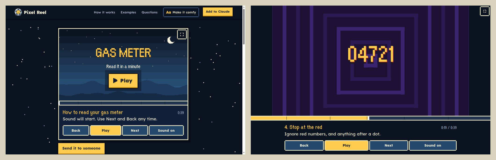 | 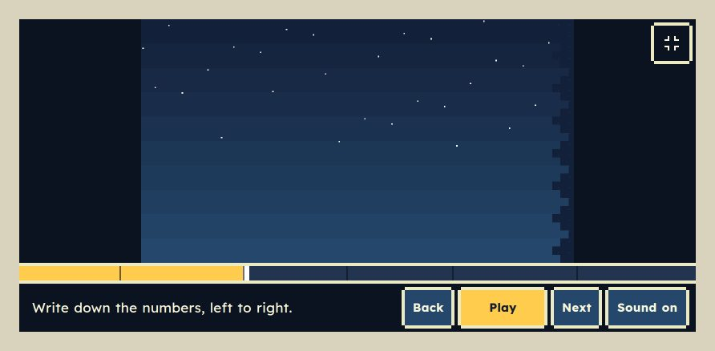 |

### Version 30

- **A reel on the lock screen.** While a reel plays, the phone now knows what it is: the
  lock screen shows the scene ("3. Read left to right"), the reel it is from and Reelie's
  picture, with Play, Pause, Next and Back. The buttons on headphones and in a car work it
  too. So a reel can be listened to with the phone in a pocket: Next goes to the next scene,
  Back to the one before, as on the player itself.
- It is the player that played last that the phone shows, and a browser with no such thing
  is left as it was.
- There is no picture of this one: a lock screen cannot be photographed from a browser.
  Checked there by reading back what the browser was told while a reel played.

### Version 31

- **Read it to me in my own language.** Where Peter can read more than English, the
  make-one box has one more choice, "Read it to me in", with each language called what the
  people who speak it call it: English, Français, Español. It starts on the language the
  browser says its reader prefers, so someone whose phone is in French finds Français
  already chosen, and it remembers what was chosen last. It is the same kind of choice as
  the ones in Make it comfy, so there is nothing new to learn.
- The reel is written in that language whatever language the thing itself is in: a letter
  in English can be explained in Spanish. Where only English is on offer, the choice is not
  there at all.

| The choice, where three more languages are switched on |
| --- |
| 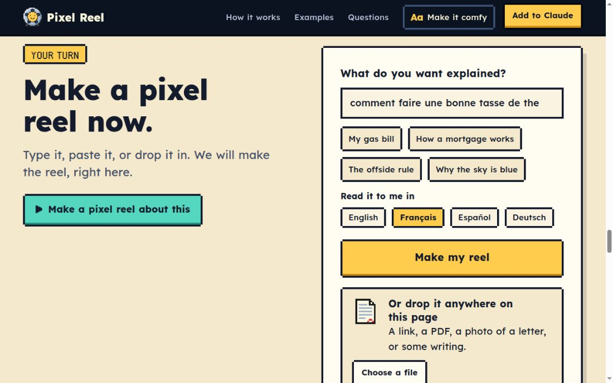 |

### Version 32

- **The whole reel on one page.** Under the player, on a made reel's page and on each
  example's, every scene is now laid out at once: its finished picture, its number, its
  title and its few words. It is there to glance back over without playing the reel again.
- **Print it.** One button, and the paper holds only that: the reel's name, then its scenes
  three across, black on white, none cut in two by the end of a sheet, and a line saying
  where it came from. Six scenes fill half a sheet of A4. How to read the gas meter can go
  on the fridge; what the pension letter said can go in the folder with the letter.
- It fills itself in once the reel is ready to play, and is not there for a reel still
  being made.

| Under the player | On paper |
| --- | --- |
| 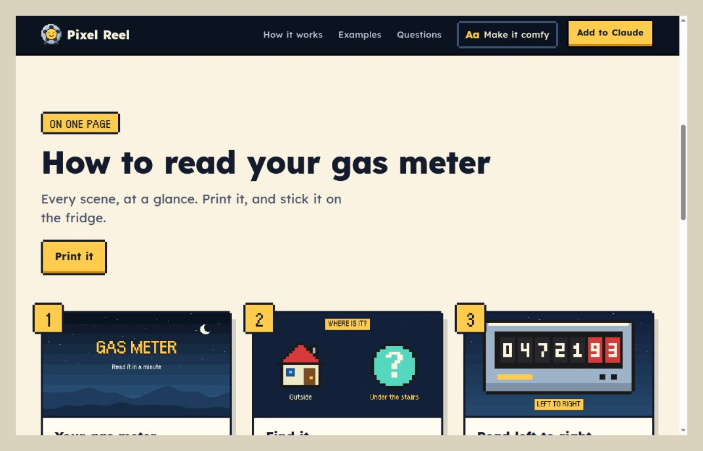 | 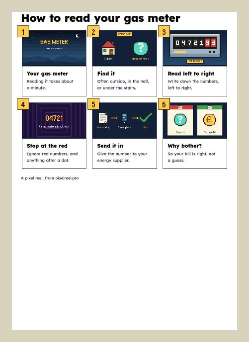 |

### Version 33

- **The narrator you chose reads the reels you make here.** With Anna chosen, the page
  says "Anna will read the reels you make", and that was true of the words written for
  Claude but not of a reel made in the box, which Peter read whoever was chosen. Now the
  box sends the choice with what it is given, and the reel's page says "Anna is recording
  scene 3 of 6" while it waits. A reel made simpler or shorter keeps whoever read it.

### Version 34

- **The reel beside the box says what the box now does.** "Make a pixel reel about this",
  next to the make-one box, played a reel about copying words across to Claude, which is no
  longer what the box does where it makes the reel itself. There it now plays a new one
  (`site-make-here`): give it anything wordy; type it, drop it or take a photo; press Make
  my reel; ask for it simpler or shorter; and find your reels listed. "Watch this whole
  page" plays it too. Where the box still writes words for Claude, the old reel stays.

### Version 35

- **The choice of language is there for everyone.** "Read it to me in" was only shown where
  Make it right here is on, so someone using their own Claude never saw it. It now shows
  wherever more than English can be read: English, Français, Deutsch, Español,
  Italiano, Português, Nederlands, each called what its speakers call it.
- **The words for Claude say it.** With Français and Anna chosen, the box writes "Make me a
  pixel reel in French, read by Anna, about this: my gas bill". The language is named in
  English there, as it is Claude who reads it. Choosing a language rewrites the words at
  once, and it is still remembered on the device and still starts on the reader's own.
- All well with seven languages showing, at 320, 390 and 1280 pixels wide, at all 27
  settings.

| The choice in the make-one box, with Make it right here off, on a laptop and a phone |
| --- |
| 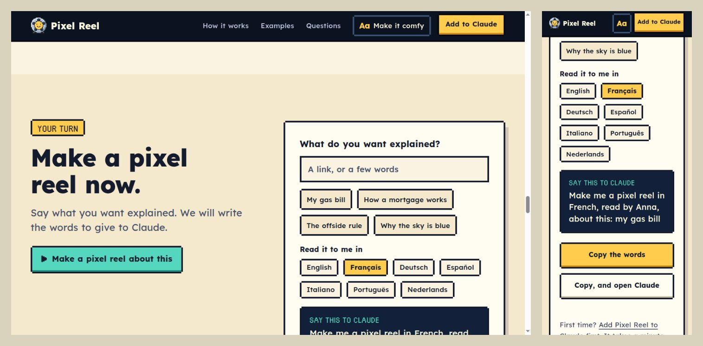 |

### Version 36

Looked at the live home page from top to bottom, on a laptop and on a phone, after an
afternoon of three people changing it. One thing was off:

- **The button that fills the screen sat on the moon.** A reel that opens on a title has a
  moon in the top corner of its picture, which is where the button was. It is in the bottom
  corner now, where pictures are plain, and where the same button is on most players.

| Before, and after |
| --- |
| 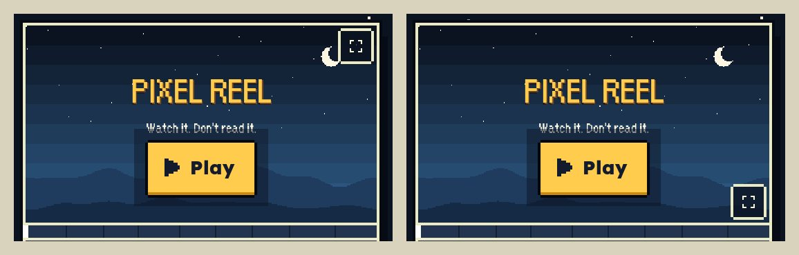 |

### Version 37

- **Follow the words.** Where every word the narrator says is written under the picture
  (the sound is off, or Every word is chosen in Make it comfy), the sentence being said
  now turns gold as it is said, and the rest stays as it was. Reading along with a voice is
  how many dyslexic readers like to read, and losing the place is what stops them.
- A recording does not say when each sentence starts, so it is worked out: each sentence
  has a share of the line's time in proportion to its letters. That is near enough for a
  sentence. It would not be for a word, which is why it is not a word at a time.
- Nothing is marked before a reel starts or once it has ended, and it keeps with the voice
  at any pace, as it uses the reel's own clock.

| The sentence being said, in gold |
| --- |
| 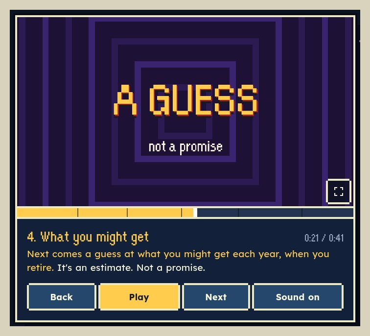 |

### Version 38

- **Three more colours of paper.** Make it comfy offered cream, blue, peach and dark. It now
  offers mint, rose and lilac too. Tinted paper is one of the commonest things people who
  find black on white hard to read ask for, and which tint helps differs from one person
  to the next, so more to choose from is the point.
- **Every paper is held to the same mark.** A test now works out how much the words stand
  out on each paper, its tinted parts and its cards: the main ink at least 12 to 1 and the
  quieter ink at least 6 to 1, where the least that is called readable is 4.5 to 1. A new
  paper that fails it fails the tests.
- **"How fast it is read"** is what Make it comfy now calls the pace, since it may be Anna
  or Stuart reading and not Peter.

| Mint, rose and lilac, and the choice in Make it comfy |
| --- |
| 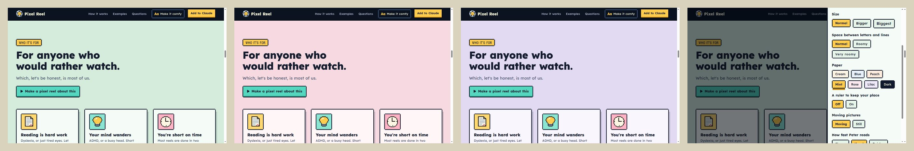 |

### Version 39

- **The page about the phone has its reel.** Every part of this site offers "Make a pixel
  reel about this", and the page that shows how to add Pixel Reel to a phone did not. It
  does now, and plays the reel made for the same part of the home page.
- **From a computer to a phone in one press.** Someone reading that page on a computer was
  told to open it on their phone, and left to work out how. The steps for a computer now
  have a button that copies the page's link, to paste into a message to themselves.

### Version 40

Looked at a made reel's page with everything three people have added to it this
afternoon: Send it to someone, Save the video, Keep it on this phone, Make it simpler,
Make it shorter, and the whole reel on one page. It holds together. One thing read badly:

- **"Kept" meant two things.** The button says "Keep it on this phone", and two lines down
  the small print said "It is kept until 22 December", meaning something else: how long
  the service holds the reel. The small print now says what happens on that day: "It is
  deleted on 22 December". Kept is left to mean the copy on the device.

### Version 41

Went back over what the site says about the narrators, and found it wrong in two ways.
Both were mine, from Version 28.

- **The credits credited one voice of six.** They named Peter's. Stuart's comes from the
  same public domain readings. Anna's, Vera's, Charles's and Paul's are modelled on
  recordings from the CSTR VCTK Corpus, made at the University of Edinburgh, and its
  licence (CC BY 4.0) asks for credit. The credits page now names the corpus, the people
  who made it and the licence, and says the four names are made up: the corpus does not
  name the people who were recorded.
- **The press kit said something untrue.** It said every narrator is "built from public
  domain audiobook readings". Only two are. It now says they are modelled on recordings
  that are free for anyone to use, and points to the credits.
- **"Cannot copy a real person" was the wrong way to put it,** in the question on the home
  page and in the terms. Every narrator is modelled on a real person's recording. What is
  true, and what they now say, is that Pixel Reel cannot be made to copy anyone else's
  voice.
- **A test now holds the credits to it.** Each narrator says where their voice comes from,
  and the test fails if the credits page leaves out that source or its licence, so a
  narrator cannot be added without one.
- On the narrowest phones the heading "Credits" was cut in two at the biggest, widest
  letters (it was before today). Page headings are a little smaller on phones that narrow.

Where each voice comes from was read from the voice model's own table of voices, and the
licences from Kyutai's page for them, not from memory.

### Version 42

- **Making a reel has a page of its own.** The form that makes a reel sat in the middle of
  the home page, among the players and the pictures, where it could be taken for one more
  of them. It is now [/make](../../site/pages/make.html): one heading, "Make a pixel reel",
  one form, and nothing on the page that plays. "Make a pixel reel" is first in the menu
  across the top of every page, and in the list at the foot.
- **The form asks everything in one place:** what to explain, which language to read it
  in, and who reads it ("Read by": Peter, Anna and the rest). The cards under Meet Peter on
  the home page still choose the narrator too, and the two agree.
- **The home page keeps its words about making one, and a big button that goes there.**
  Every other way to the form goes to the page as well: the buttons at the top and the foot
  of the home page, "Try something else" on a reel that could not be made, the shortcut on
  a phone's home screen, and something shared from a phone's Share menu.
- Your reels, and dropping something anywhere on the page, moved with the form.

| The make page, and what the home page keeps |
| --- |
| 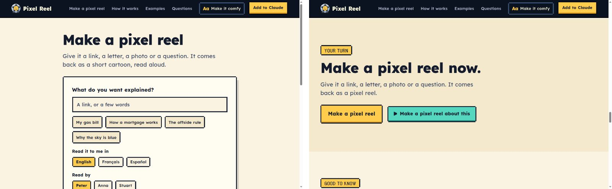 |

### Version 43

Went looking for the ways a link to a reel goes wrong before anyone sees the reel.

- **A link with a full stop after it said "Nothing here".** Someone ends a sentence with
  the link, the full stop is copied with it, and the person it was sent to is told there
  is nothing at that address. The same with a bracket, a comma, a quotation mark or a
  space after it, with a slash on the end, and with `/R/` for `/r/`. All of those now
  go to the reel. Its id is never changed (capitals count in it), and nothing is guessed:
  if what follows the id has a letter or a number in it, it is some other id.
- **Pages typed by hand** get there too: `/Claude`, `/claude/`, `/claude.` and
  `/claude.html` all go to `/claude`, and so on for every page, each example reel's page
  and the short address `/add`, which is made to be said aloud and typed on a phone.
- **A link meant for a reel that is not the shape of one** (cut short, say) used to get
  "Nothing here". It now gets "No reel here", which says the link may not be quite right.
- **"No reel here" said the reel had been "kept past its 30 days"**, which takes two
  readings to follow, and used "kept" for something other than a copy on a device
  (Version 40). It now says: "This reel has been deleted. Every reel is deleted after 30
  days. Or the link is not quite right." The player says the same when a reel goes while
  its page is open.

Tried in a real browser with the service worker in charge of the page, since it answers
every page request first: each of eleven nearly-right addresses landed where it should.

### Version 44

Looked at the home page on a phone, where it is 18,000 pixels from top to foot.

- **A phone had no menu.** The links across the top (Make a pixel reel, How it works,
  Examples, Questions) go when the bar has no room for them, which is on every phone and
  every tablet, and on a laptop with bigger letters. Nothing took their place: the only way
  round a very long page was to scroll it. There is now a Menu button in the bar wherever
  the links are not. It opens them as a list of big rows, a picture and a few words each,
  with Home, Add to your phone, Make it comfy, and Add Pixel Reel to Claude at the foot.
- **What the bar lets go of, and in what order.** On a phone the name beside Reelie goes,
  to make room for Menu: Reelie still leads home, and so does the first row of the menu.
  At the very biggest, widest letters on the narrowest phone the Aa button goes too, since
  Make it comfy is in the menu by name.
- **The rows never cut a word.** Each row's words sit beside its picture while the longest
  of them has room there, and go under it when it has not.
- Found on the way, at the biggest OpenDyslexic letters on a phone 320 pixels wide: "Watch"
  in the heading at the top of the home page was cut in two, and Make it comfy's own panel
  was wider than the screen when OpenDyslexic was the one chosen. Both fit now.

`scripts/site-fit.js` does not look inside a dialog, so the menu and Make it comfy were
measured by hand at that size: neither is wider than the screen.

| The bar on a phone, and the menu it opens |
| --- |
|  |

### Version 45

- **From a computer to a phone with no address to type.** The page about the phone told
  someone on a computer to "open this page on your phone", which means typing an address,
  letter by letter, on a small keyboard: hard work for the very people the site is for.
  There is now a QR code to point the phone's camera at, in the steps for a computer on
  that page, and on the home page under "Keep it a press away". On the home page it has a
  few words beside it, "On a computer now?", and shows only where there is a mouse: a
  phone has no use for a code that opens what it is already showing.
- **It is pixel art.** One square of the code is one pixel of the page's pixel art (`--u`),
  and it has the same notched edge as everything else. It stays dark on light on every
  colour of paper, Dark included, because a camera needs it that way round.
- **Made here.** The site loads nothing from anywhere else, so the code is made by the
  site's own `site/js/qr.js`, as the standard lays down, and drawn into the page as SVG by
  the service. No script runs for it in the browser.

How it was checked: the correcting codewords against the standard's own worked example,
the fifteen format bits against its table, and then a real reader (zxing-cpp) read back
codes of all six sizes and all eight masks, and the code itself from screenshots of both
pages. Not yet pointed at with a real phone.

| Under "Keep it a press away" on the home page, and in the steps for a computer |
| --- |
|  |

### Version 46

- **Paper that can talk.** A reel printed for the fridge was only its pictures and their few
  words: everything Peter says was left behind on the screen. The printed page now carries
  the reel's own QR code under its title, with "To hear it read out, point a phone's camera
  at this square." Point a phone at the fridge, and the reel plays, voice and all.
- **It says until when.** A made reel is deleted after 30 days, and the paper outlives it.
  So for a made reel the paper says "It works until 22 December", the same day the page
  gives. A reel of the site's own (the examples) has no such line: it stays.
- **On a screen, the same code is for watching on a phone.** Beside "Print it", where there
  is a mouse: "Watch it on your phone. Point its camera at this square." Someone who made a
  reel on a computer can take it to the sofa without sending themselves a link.
- A page whose address is too long to make a code of (a service at a very long address) goes
  without the code and its words, and is still made.

The code holds the reel's link and nothing else: the same link the page already shows in
its address bar, and the one "Send it to someone" passes on.

Tried with a made reel on a stand-in service (a stand-in recorder, no voice): the page as
it would print, at the size of a sheet of A4, was read back by a real reader (zxing-cpp) to
the reel's own address. Not yet printed on real paper, nor pointed at with a real phone.

| On a screen, beside Print it, and on paper |
| --- |
|  |

### Version 47

Went down the whole home page on a phone with the paper set to Dark. It holds up. Two
things did not:

- **The phone had vanished.** The picture of a phone under "Keep it a press away" (and at
  the top of the page about the phone) is nearly black, so on Dark paper only its screen
  showed, a grid of coloured squares floating in the dark. It now has a light pixel edge
  there, like every card on Dark paper.
- **The letter dazzled.** Dark paper is chosen so that nothing dazzles, and the made-up
  pension letter in "Same letter. Two ways to take it in." stayed bright white: the one
  white thing on the page. On Dark paper it is now the grey of paper in a dim room. It is
  still paper, and still as dense as ever.

| The letter and the phone on Dark paper |
| --- |
| 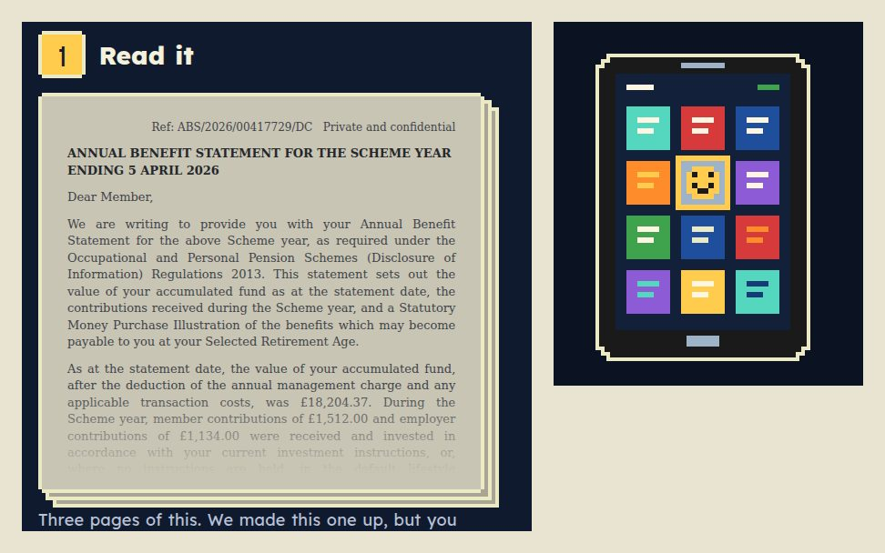 |

### Version 48

Read the page that adds Pixel Reel to Claude as someone on a phone would: a reel sent in
a message is likely to be opened on one, and its page leads here.

- **The advice for a phone came after the pressing.** "On a phone? It is easiest to add it
  on a computer" was the second-to-last thing on the page, under Plan B, long after the big
  button. Someone on a phone or a tablet now gets it at step 1, straight under the button.
  The note at the foot is left for people on a computer, so nobody reads it twice.
- **And a way to do something about it.** The note has a button, "Send it to my computer",
  which opens the phone's own way of sending things with this page's link, to email or
  message to themselves. What it sends says what the page is ("How to add Pixel Reel to
  Claude"), not "as a pixel reel. Press Play.", which a page is not.
- **A test that every page closes what it opens.** Making this, a stray closing tag put the
  step's picture outside its step, and only looking at the page showed it. A test now counts
  the tags of every page.
- Found on the way, at the biggest, roomiest OpenDyslexic letters on a phone 320 pixels
  wide: "connector" was cut in two in the pretend "Add a connector" box. It fits now.

Tried in a headless browser that says it is an iPhone, with a stand-in for the phone's
share sheet. Not tried on a real phone.

| Step 1 on a phone |
| --- |
| 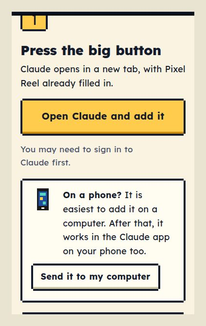 |

### Version 49

Olly, of the make page: "it's just not an intuitive form, is it?" People should "just know
how to use it by looking at it". So it was looked at as someone who has never seen it, on a
phone and on a laptop, and counted.

What was wrong. The box was one thin line under "What do you want explained?", which does
not say a link goes there. Between it and the button that makes the reel stood 17 other
things to press: four things to try, seven languages and six narrators. On a phone the
button was 1,170 pixels down, past the first screen and half the second. A photo and a PDF,
the way in for a letter or a bill, came after the button, in a box that read as a footnote.
And a link had to be pasted by pressing and holding in the box, which is fiddly.

- **One big box that says what goes in it: "Paste a link here."** A picture of a link sits
  beside the words, and inside the box it says "Or type a question".
- **A Paste button, in the box.** One press puts in whatever was last copied. The words
  land in the box to be looked over, not sent, because a clipboard can hold anything; the
  page then says "Pasted. Now press Make my reel." A copied picture (a screenshot of a
  letter) is made into a reel at once, as a dropped one is. The button shows only where
  the browser lets a page read what was copied, and if the browser or the person says no,
  the page says to paste in the box instead.
- **The big button is straight under the box**, and bigger. On a phone it now ends 640
  pixels down, on the first screen; on a laptop, 697 of 800.
- **Nothing to decide before it.** Who reads, and in which language, is one line: "Read by
  Peter in English", the two names as chips with a little arrow. Press it and the choices
  open under it, the same ones as before. It starts on the choice made last time, or the
  browser's own language.
- **A photo and a PDF have a button each**, under a line: "Take a photo" (on a phone;
  "Choose a photo" with a mouse) and "Choose a PDF". Each opens the chooser showing only
  that kind. Dropping anything anywhere on the page still works, and says so in a quiet line.
- **Things to try moved under all that**, since they are for someone with nothing in hand.
  Pressing one fills the box and brings it and the big button back onto the screen.
- Kept as they were: the limits, the messages when something cannot be made, the wait and
  the page a reel is watched being made on, Your reels, sharing from a phone, and "Use your
  own Claude instead". With Make it right here off, the same box writes the words for Claude.

Checked with `scripts/site-fit.js` at 320, 390 and 1280 pixels wide, as the page opens and
with everything on it opened: nothing cut in two or too wide at any of the 27 settings.
The Paste button was pressed in a headless browser with a stand-in for the clipboard; it
has not yet been pressed on a real phone.

| The first screen on a phone, before and after |
| --- |
| 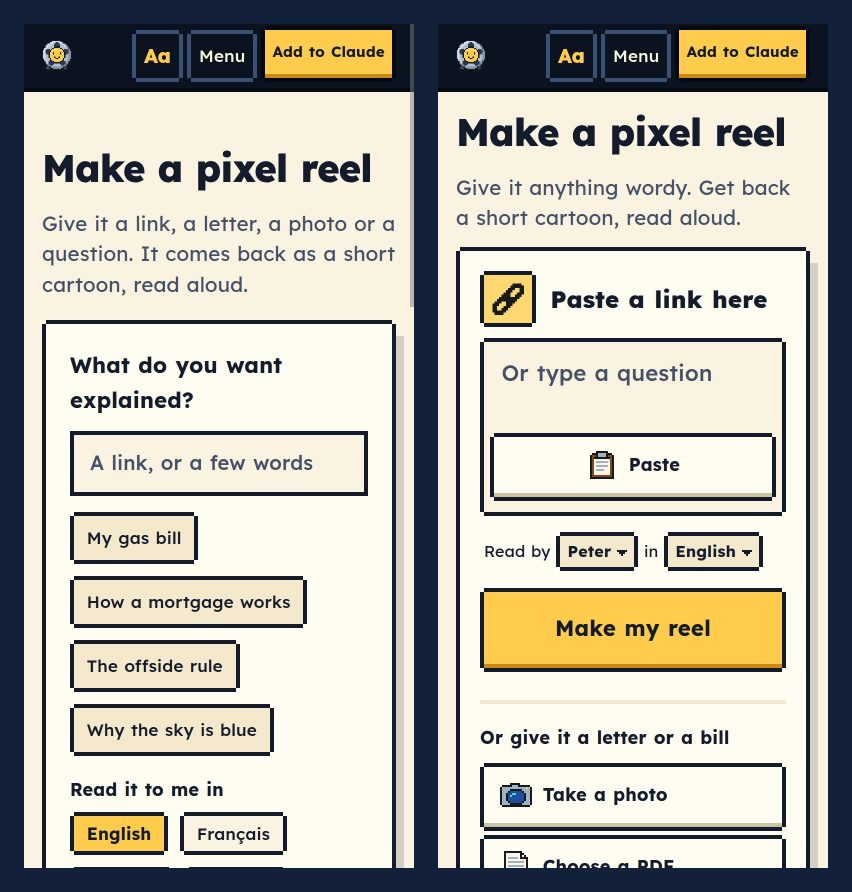 |
