# The website

The website at the service's own address ([pixelreel.pro](https://pixelreel.pro)): what Pixel
Reel is, how to add it to Claude, the press kit, and privacy, terms and credits. The
[service](../service.md) serves it, and everything it shows lives in [`site/`](../../site).

- [Who it is built for](#who-it-is-built-for)
- [How it fits together](#how-it-fits-together)
- [Changing it](#changing-it)
- [The reels it plays](#the-reels-it-plays)
- [Design log](#design-log)

## Who it is built for

People who find reading hard work. Every choice follows from that:

- **Letters.** Lexend, large (20px, 18px on a phone), with open spacing and lines no longer
  than about 60 characters. Never justified, never in italics, never all in capitals for a
  sentence.
- **Words.** Short sentences in everyday words, a few to a section. No walls of text.
- **Whole words.** No word is ever cut in two at the end of a line, whatever the screen and
  the letters. When there is not room, things go under each other instead.
- **Paper.** Dark ink on cream rather than black on white, which dazzles some readers.
  Words never sit on a pattern or a picture: even the stars keep clear of them.
- **Buttons.** Every main thing to do is a big button that says what it does.
- **Make it comfy.** A panel on every page changes the letters (Lexend, Atkinson
  Hyperlegible Next or OpenDyslexic), their size and spacing, the colour of the paper, and
  whether pictures move. It is kept on the reader's device only.
- **Watch instead.** Every part of the home page has a "Make a pixel reel about this" button
  that plays a reel of that part, made earlier. "Watch this whole page" plays them all.
- **Calm.** Sound only ever starts on a press. Pictures hold still for anyone whose device
  asks for less motion, or who chooses Still.

Pixel art is for pictures; words are always in plain letters. One pixel of the page's pixel
art is `--u` (4px) wide everywhere, so buttons, borders, icons and scenery sit on one grid.

The voice is Peter's: warm, plain, British, a little cheeky. Plain dashes only.

## How it fits together

| File | Does |
| --- | --- |
| `site/layout.html` | The shell every page shares: the bar across the top, the foot, Make it comfy and the theatre. |
| `site/pages/*.html`, `*.md` | A page each. The comment at the top holds its `title` and `description`. Plain pages are Markdown. `reel.html` is the page every shared reel is watched on (`/r/<id>`), and `watch.html` the page each of the site's own reels has to be sent by (`/watch/<name>`: the examples in `EXAMPLES`, in `service/site.mjs`, which also writes their posters). |
| `site/css/site.css` | The whole look. |
| `site/js/` | `main.js` wakes the page up; `player.js` is the player; `theatre.js` plays a reel over the page; `shots.js` draws reel pictures as illustrations; `scenery.js` and `landscape.js` draw the night scenes; `comfort.js` is Make it comfy; `boot.js` runs before the page is drawn, to put its settings back and to keep the bar across the top on one row; `signal.js` is the test card on a page that is not there; `maker.js` writes what to say to Claude; `watch.js` is the page a shared reel is watched on; `send.js` copies words and passes a reel on; `sprites.js` is the site's own pixel art. |
| `site/fonts/`, `site/art/` | The fonts (with their licences), and the icons, logos and share picture. |
| `service/site.mjs` | Puts a page together: the layout, the page, and the `{{names}}` in them. |
| `service/static.mjs` | Serves the files a page loads, and only those. |
| `scripts/site-art.mjs` | Draws `site/art/` from the sprites and the landscape (`npm run site-art`). |
| `service/try.mjs`, `service/writer.mjs` | Make it right here, where the service has Claude write a reel for a visitor. Off by default: [service.md](../service.md#make-it-right-here). |

A page can say `{{url}}`, `{{mcp}}` (the connector's address) and `{{add}}` (the link that
opens Claude with the connector filled in), `{{icon:letter:4}}` for an everyday icon and
`{{sprite:reelie:2}}` for one of the site's own, drawn as crisp SVG four (or two) pixels to
the pixel, and `{{player:pixel-reel}}` for a player of a reel in `reels/`.

The player is the real one underneath: `site/js/player.js` uses the same timing, narrator,
kit and transitions as `src/main.js`, with the site's own buttons round it. The pages work
without JavaScript, except that reels need it to play.

A page loads nothing from anywhere else, sets no cookies, and its content security policy
(`SITE_POLICY` in `service/site.mjs`) allows only the site's own files. That rules out
inline styles and scripts, so pages have none (`test/site.test.js` checks).

Search engines are asked to keep out (`noindex`, and `/robots.txt`) for as long as Pixel
Reel is by invitation. `PIXELREEL_LISTED=1` lets them list the website. Reels are never
listed: every `/r/` answer says `noindex`.

## Changing it

```sh
npm run service          # http://localhost:8787, picking up changes on reload
npm test                 # test/site.test.js and test/service.test.js cover the site
npm run site-art         # after changing Reelie or the landscape
```

Look at every change at three sizes (1440 x 900, 1280 x 720 and 390 x 844), and with
Make it comfy set to Dark, to Biggest, to OpenDyslexic (a third wider than Lexend, so it
finds what does not fit) and to Still.

No test can see how a page is laid out, so [`scripts/site-fit.js`](../../scripts/site-fit.js)
does it in a browser: paste it into the console of a page, at a phone's width and at a
laptop's, and it tries all 27 settings of Make it comfy and says where the bar across the
top is on two rows, where a word is cut in two, and where the page is wider than the
screen. Fix a layout it complains about by letting it reflow (a `flex-basis` or a column
width in `ch`, which grows with the letters), not by a rule for one size of screen.

## The reels it plays

All are `reel.json` reels in `reels/`, written the way Claude writes them through the
connector (ready-made pictures only) and recorded by Peter with `npm run voices`:

| Reel | Where |
| --- | --- |
| `pixel-reel` | The player at the top of the home page. |
| `site-what`, `site-how`, `site-who`, `site-peter`, `site-make`, `site-good`, `site-questions` | "Make a pixel reel about this", one for each part of the home page. With `site-open`, they are also "Watch this whole page". |
| `site-open` | The reel for "It is all open", and the code typing out beside it. |
| `site-privacy`, `site-terms` | "Make a pixel reel about this" on the privacy and terms pages. A plain page gets the button by naming a reel in the comment at its top (`reel: site-privacy`). |
| `gas-meter`, `pension-letter`, `volcano`, `cup-of-tea`, `offside-rule`, `blue-sky` | The examples under Now showing. `pension-letter` also plays beside the letter in "Same letter, two ways". |

Change a reel's words and it needs recording again (`npm run voices <name>`); a test fails
until it is. Change what a part of the page says, and change its reel to match. A picture's
`start` and `every` are set to when Peter says the words, so check them after re-recording.

## Design log

### Before (22 November 2026)

The home page was five paragraphs of Markdown on dark blue, with a text link to add Pixel
Reel to Claude. Nothing to watch, on a site about watching.

| Desktop | Phone |
| --- | --- |
| 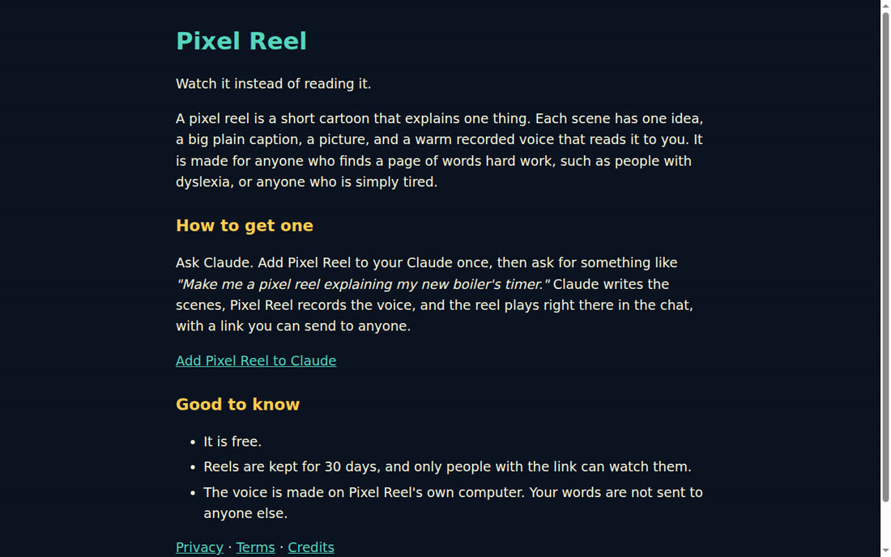 |  |

### Version 1

A first whole page: a night-sky top with the player beside the headline, then cream paper for
reading. What was wrong with it, looked at hard:

- The headline broke into three lines, and pushed the buttons off the first screen.
- Words sat on a dithered sky and among the stars, which is hard on exactly the readers the
  site is for.
- The big Play button sat on top of the reel's own title.
- The landscape was below the fold, so the first screen ended in plain dark blue.

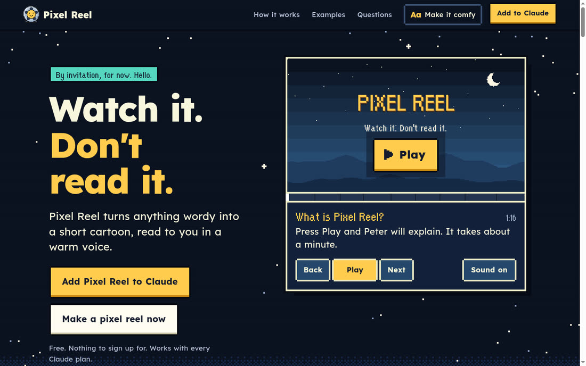

### Version 2

- The headline is two lines, as it is said: "Watch it. Don't read it."
- The sky is plain behind every word. Stars keep out of the way of text, and the dawn glow
  starts below it.
- Play sits under the reel's title, not on it.
- The whole first screen fits a laptop: headline, both buttons, the player, and the hills
  with Reelie on them.
- The page turns from night to day as the hills meet the paper, and back to night at the
  foot, where Reelie is asleep.
- Phone: the bar across the top fits on one line, the player's buttons fit on one row, and
  lists put their icon beside the words to save scrolling.
- Found by looking at a picture of it: the theatre could open off the screen when the page
  was scrolled. Fixed.

| Desktop | Laptop |
| --- | --- |
|  |  |

| Now showing | A reel about a part of the page | Phone |
| --- | --- | --- |
| 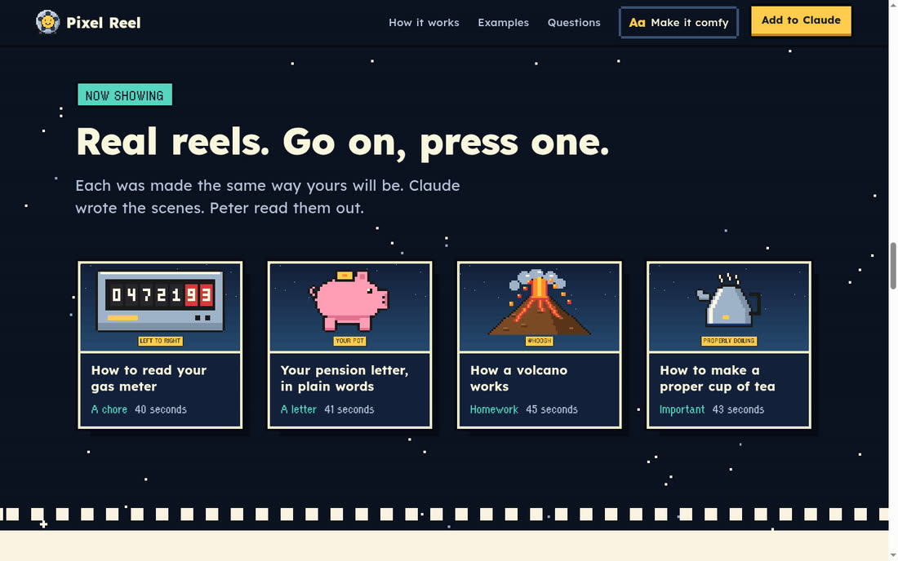 | 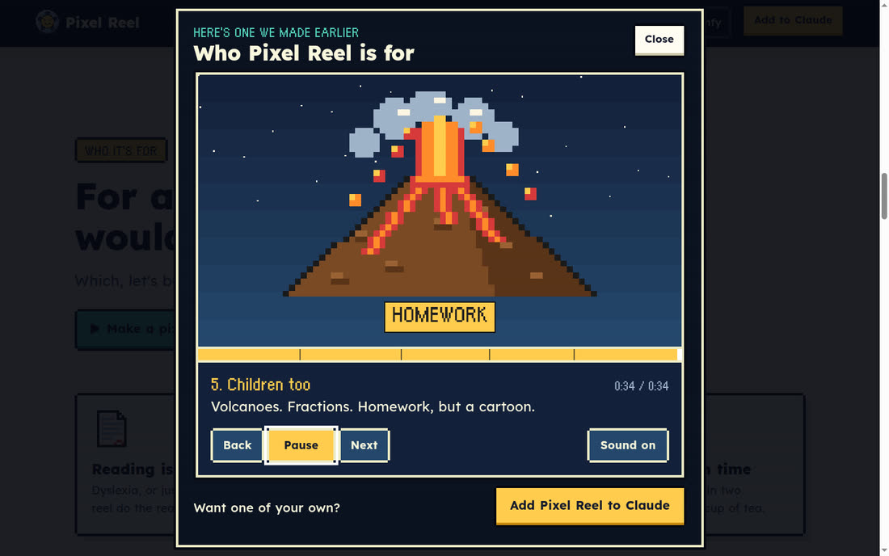 | 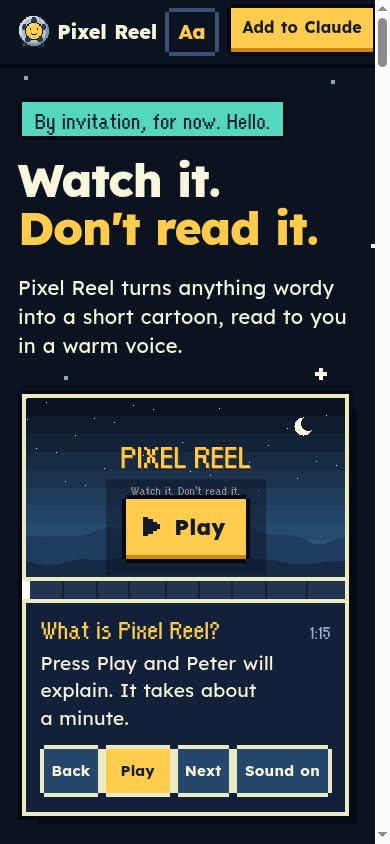 |

### Version 3

Looked at again, version 2 explained Pixel Reel well but never let anyone feel the
difference, and the middle of the page was all cream cards.

- **Same letter, two ways.** Straight after the top, a dense pension letter (small, grey,
  justified: everything this site is not) sits beside the reel of the same letter. The
  letter is a picture of a letter, hidden from screen readers, who are told what it is.
- **Watch this whole page.** A button at the top plays the reel for each part of the page,
  one after another: the whole site, as a reel. Next on a reel's last scene skips on.
- **Pictures on the word.** Every clip was run through speech-to-text to find when each word
  is said, and each list, row of icons and chat now arrives as Peter says it. An answer no
  longer shows before its question has been asked.
- **Colour.** The "who it is for" cards have a coloured tile behind each icon.
- **The big Play button** keeps off the picture's own words: under a title, in the middle
  of anything else.
- **A way home.** Every shared reel's page now says "Made with Pixel Reel" under the player.
- **Checked by machine as well as by eye:** Lighthouse gives accessibility 100 and best
  practices 100 on the home, Claude, press and privacy pages at phone size. It found one
  real fault: on a phone the Make it comfy button had no name for a screen reader. Fixed,
  and a test now checks every button has one.
- **Faster:** a page now asks for all its scripts at once, and the first reel with them,
  rather than finding out about each from the one before.

| The top, with Watch this whole page | Same letter, two ways | Who it is for |
| --- | --- | --- |
| 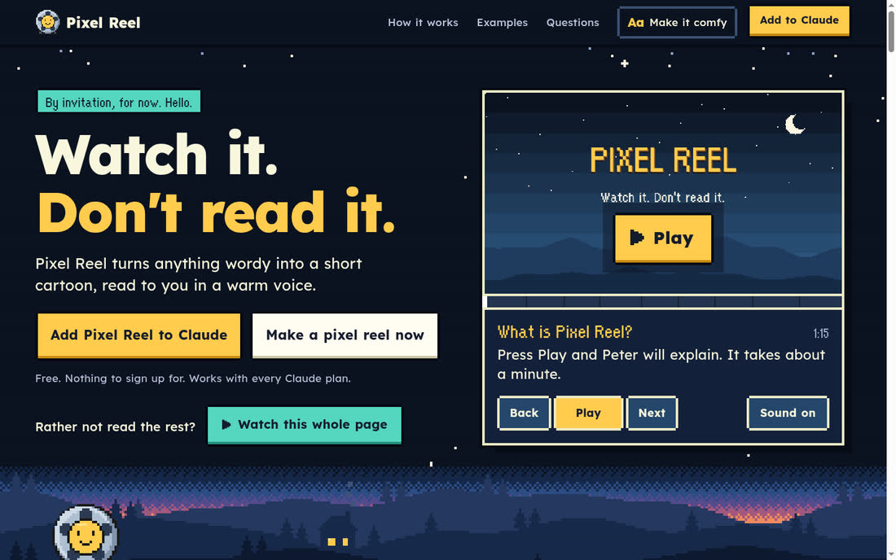 |  | 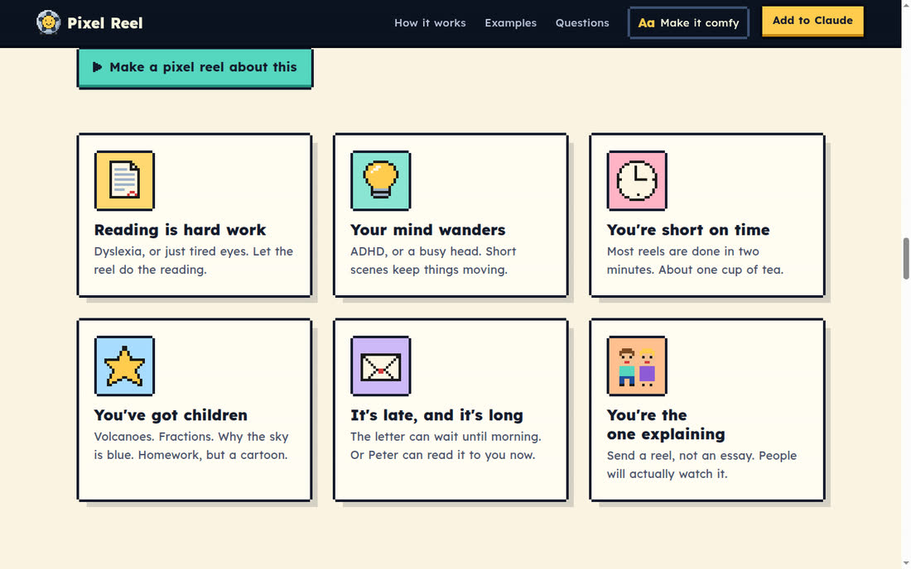 |

### Version 4

The page a shared reel lands on is where most people will meet Pixel Reel, and it still
looked like the old site.

- **A shared reel's page** (`/r/<id>`) is now the website's own: the same player, Make it
  comfy, a night sky, and "Want one of your own?" underneath. It says how long the reel is
  kept, and offers the video once one has been made.
- **Waiting is a scene of its own.** The page used to say "Nearly ready" and reload itself
  every five seconds. Now it is there at once, Reelie waits on screen under a RECORDING
  sign, and the reel appears the moment Peter has finished.
- **A link sent in a message** shows a card ("A pixel reel for you") and the reel's title.
  The page itself holds none of the reel's words.
- **Privacy and terms, as reels.** Both pages have "Make a pixel reel about this" straight
  under the heading. Nobody reads the terms; now they can watch them.
- **It is all open.** A part of the home page for the curious, with a reel of its own, and
  code typing itself out beside it.
- **Looked at with Make it comfy turned up,** which found two faults: at the biggest
  letters on a phone the bar across the top and the player's buttons ran off the side of
  the screen. Both now wrap. Pictures drawn on a canvas no longer take on the page's letter
  spacing.

| A shared reel | Waiting for the voice | It is all open |
| --- | --- | --- |
|  |  |  |

### Version 5

- **Six examples, not four.** Now showing gains "The offside rule, at last" and "Why the sky
  is blue", each with pixel art drawn for it: a football pitch with the last defender's line
  marked, sunlight fanning out into its colours, a sunset. The posters sit three by two.
- The two questions the make-one box suggests (the offside rule, why the sky is blue) are now
  ones a visitor can watch the answer to on the same page.

| Six examples |
| --- |
| 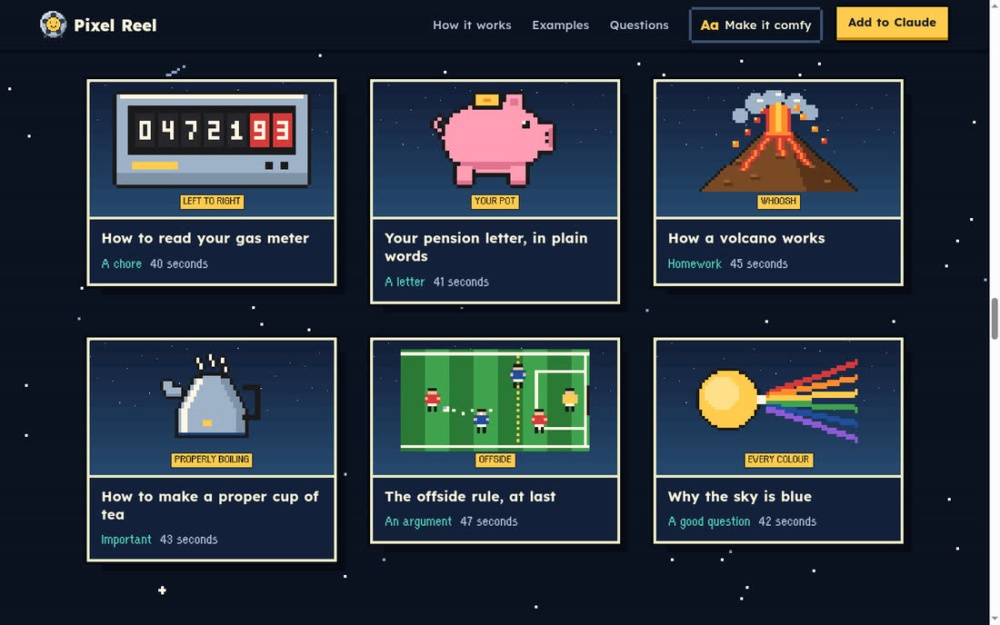 |

### Version 6

- **Make it right here, built and switched off.** Until now a visitor needed Claude to get a
  reel. The make-one box can now offer a second button that has the service ask Claude for
  them, and takes them to the reel's page to wait for the voice. It costs money for every
  reel, so it is off, and the button is not on the page at all, until it is switched on
  ([service.md](../service.md#make-it-right-here) has the costs and the safeguards).
- Tried with a stand-in for Claude from the button through to a reel ready to play.

| The button, when it is switched on |
| --- |
|  |

### Version 7

- **A film for the press kit.** The reel at the top of the home page, drawn frame by frame
  into an MP4 with `npm run video pixel-reel -- --scale 3`, words on screen, to drop into a
  post or a piece (`site/art/what-is-pixel-reel.mp4`; make it again if that reel changes).

### Version 8

- **The bar across the top stays on one row.** It had been wrapping onto two: on most phones,
  and on a laptop for anyone who chose OpenDyslexic or bigger letters, which is who the site
  is for. Fixed rules could not know how wide the letters would be, so now `boot.js`
  measures, before the page is drawn, and lets go of one thing at a time until the rest
  fits: the links, the words on the comfort button, the name beside Reelie, and last the end
  of "Add to Claude". Checked at fifteen widths, three typefaces and three sizes.
- **Nothing on this channel.** A page that is not there, and a reel that has gone, now show
  the player's own "no signal" test card, flickering (and still, when asked).
- **Reelie says hello**, once, when you first scroll down to it. The scenery is now drawn
  at the page's full resolution, so words in it are as crisp as the page's.
- The focus ring in the bar across the top was dark blue on dark blue. It is white now.
- The player's four buttons fit on one row on a phone again.

| Biggest OpenDyslexic letters on a laptop: before, after |
| --- |
| 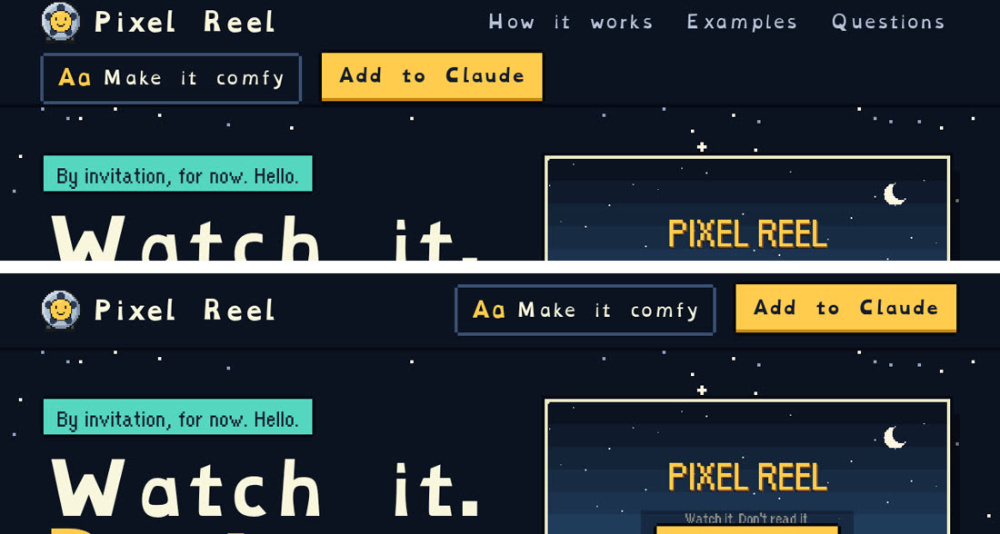 |

| On a phone: before, after, and the same with the biggest OpenDyslexic letters |
| --- |
| 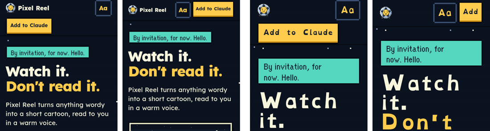 |

| A page that is not there | Hello |
| --- | --- |
|  | 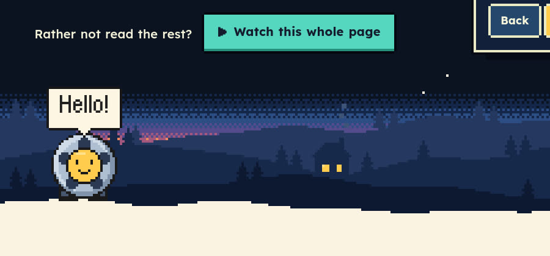 |

### Version 9

- **Whole words.** With the biggest letters, the cards in "For anyone who would rather
  watch" cut their words in two: "Readin g", "childre n". Their words now go under the
  picture when there is not room beside it, and the cards go from three across to two when
  three would be too narrow, both measured in the width of the letters themselves.
- The player's buttons share out their rows, so they are tidy on one row or on three.
- Shooting stars pass behind the words now, never across them, and keep clear of the film.
- The connector's address breaks before "/mcp" on a narrow screen, not mid-word, and the
  little arrow after "Show me how" stays with its last word.
- `scripts/site-fit.js` checks all of this in a browser. It finds no fault on the home page at
  18 widths of screen, nor on the other pages at a phone's width and a laptop's.

| Biggest OpenDyslexic letters on a phone: the cards and the player, before and after |
| --- |
| 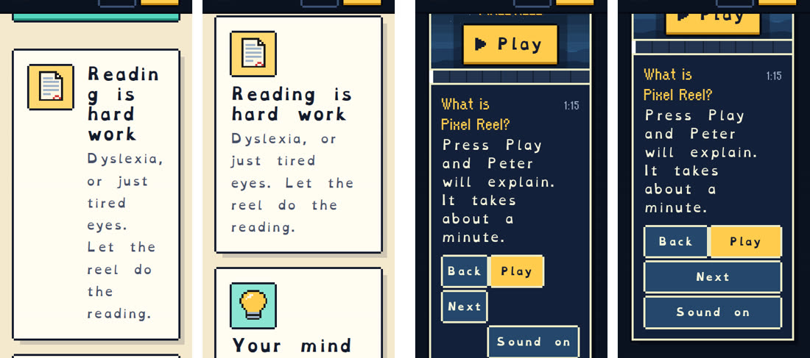 |

### Version 10

The page a shared reel is watched on is where a reel does its work, so it got the round.

- **Send it to someone.** A reel is made to be passed on, and its page had no way to do it.
  The new button opens a phone's own way of sending things (WhatsApp, a message); on a
  computer it copies the link and says so.
- **A bigger reel.** The page said the reel's name twice, once above the player and once
  inside it, and the first pushed the player down and made it small: about 480 pixels wide on
  most laptops. Now the player says it alone, and is as big as will leave its picture, its
  words and its buttons all on the screen: about 690 wide on a 1280 x 800 laptop.
- **Bigger buttons.** In every player the four buttons now share out their row, so they are
  larger, and tidy however narrow the player. "Sound on" no longer drops off the end.

| A shared reel on a 1280 x 800 laptop: before, after |
| --- |
|  |

### Version 11

- **A reel's link shows the reel.** Sent in a message, every reel's link used to show the
  same card. Now it shows that reel's own first picture, in a frame, over a band with a
  play button, the reel's name and Reelie: "GAS METER", not "A pixel reel for you". The
  service draws it (`service/card.mjs`) the first time a message asks, which can be before
  the voice is recorded, and keeps it with the reel. The old card still stands in if a
  picture cannot be drawn.

| What a message showed for every reel | What it shows now, for two of them |
| --- | --- |
| 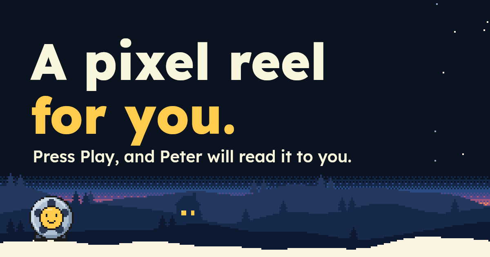 | 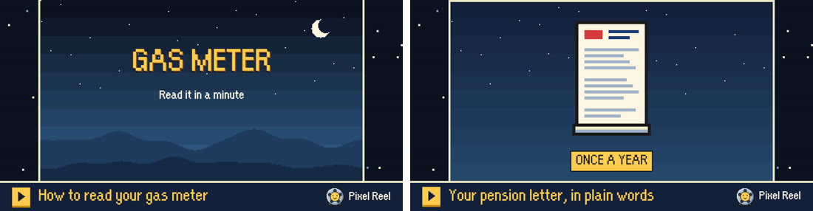 |

### Version 12

- **A page for each example, to send.** The reel that explains Pixel Reel, and each of the
  six examples, now has a page of its own: `/watch/pixel-reel`, `/watch/offside-rule` and so
  on. The reel is as large as the screen allows, with Send it to someone under it, then the
  way to get one of your own, then the others to watch. Sent in a message, its link shows
  that reel's own picture. `/watch/pixel-reel` is the one link that explains the whole
  thing to someone in a minute.
- The player that opens over the home page has Send it to someone for those reels too,
  which sends the reel's own page.
- A reel's length now reads the same on its poster as on the player's clock.

| An example's page, on a laptop and a phone | What a message shows for it |
| --- | --- |
| 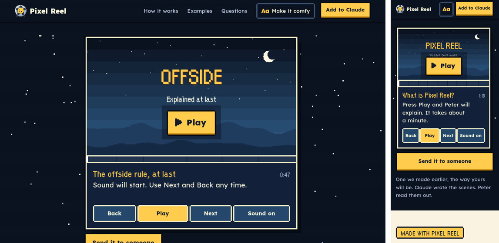 |  |
